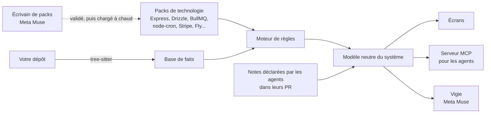

<p align="center">
  <picture>
    <source media="(prefers-color-scheme: dark)" srcset="assets/banner-dark.png">
    
  </picture>
</p>

<p align="center"><sub><a href="README.md">Read in English</a></sub></p>

<br>

Les agents de code écrivent maintenant la plus grande partie de notre code, et ils l'écrivent bien. Relire chaque ligne n'est plus le travail. **Comprendre le système, si.** VisionLayer lit votre dépôt, sans aucun modèle de langage, et montre le système tel qu'il tourne : qui peut appeler quoi, qui écrit dans quelle table, ce qui démarre à 3 h du matin. Chaque fait cite son fichier et sa ligne. Ensuite, il garde ce que vos agents savaient en écrivant le code, et vous permet de vous mesurer aux vrais problèmes qu'ils ont rencontrés.

## Le problème

Quand les agents écrivent le code, quatre choses se perdent sans bruit.

| | Ce qui se perd | À quoi ça ressemble |
|---|---|---|
| **1** | **Le système devient une boîte noire** | Personne ne sait plus dire qui peut appeler quoi, ce qui tourne tout seul, ni qui écrit dans une table. La réponse est dans le code, dispersée dans des dizaines de fichiers. |
| **2** | **Ce que l'agent savait meurt avec sa session** | Pourquoi il a choisi cette solution, la panne qu'il a rencontrée, la règle métier qu'il devait suivre. Relire le code plus tard ne le ramène jamais. |
| **3** | **Les décisions se prennent à l'aveugle** | Faut-il fusionner cette PR ? Touche-t-elle aux paiements ? Le README dit-il encore vrai ? Sans vue du système, on décide sur la confiance. |
| **4** | **L'ingénieur perd la main** | Quand l'agent résout tous les problèmes difficiles, l'ingénieur ne les résout plus. Le jour où l'agent se trompe, plus personne n'a l'instinct de le voir. |

## Ce que fait VisionLayer

**Zoomer du système entier jusqu'à une ligne.** On part de ce qui tourne et de ce qui appelle quoi. On descend niveau par niveau, et on ouvre le code exact à la fin.

| Niveau | La question à laquelle il répond |
|---|---|
| Système | De quoi est-il fait, et qu'est-ce qui appelle quoi ? |
| Un bloc | Que contient ce service, ce worker, cette base ? |
| Une question transversale | Qui peut entrer ? Qui écrit cette table ? Qu'est-ce qui tourne sans clic ? |
| Une feature | Que se passe-t-il, étape par étape, quand un client paie ? |
| Une fonction, une ligne | Quel code fait exactement cela ? |

**Voir ce que fait chaque fonctionnalité.** L'écran **Fonctionnalités** regroupe chaque point d'entrée par ressource et le dessine en chaîne, dans l'ordre du code : lectures, refus, écritures, bornes de transaction, réponses. Un clic ouvre son déroulé complet.

**Suivre un processus à travers les routes.** L'écran **Parcours** prend une donnée à états, comme une réservation, ou une file, et montre ce qui la fait avancer : l'appel du client, le webhook Stripe, la tâche planifiée, chacun avec ses gardes, ses lectures et écritures, et ce qui reprend sur une file. Calculé depuis le code, sans modèle de langage.

**Lire l'algorithme quand il le faut.** Une feature est tracée dans l'ordre où le code l'exécute : la route, la garde, la lecture en base, l'écriture, le message mis en file. Chaque étape ouvre sa ligne.

**Décider sur des faits.** VisionLayer montre ce qui mérite qu'on aille voir, et dit comment il l'a trouvé. Ce qu'il ne sait pas lire est marqué *non lu*, jamais *sûr*.

**Garder ce que savent les agents.** Les agents reçoivent un contrat court : lire la carte avant la tâche, déclarer dans la PR ce que le code ne dit pas. Chaque note est ancrée sur la fonction qu'elle explique, et revérifiée contre le code à chaque changement : *vérifiée*, *périmée* ou *contredite*. Les notes apparaissent là où elles expliquent quelque chose, pas dans un wiki à part.

**Donner la carte aux agents plutôt que de les laisser relire.** Le même modèle est servi aux agents de code par MCP. Le déroulé complet d'une feature coûte environ **1 250 tokens au lieu de 6 600** pour lire le fichier, et il arrive avec ce que les agents précédents ont déclaré.

## Ce qu'il a trouvé dans une vraie application

atelier-api est une vraie application Express, Postgres et Stripe qui nous sert de terrain d'essai. VisionLayer a signalé tout ceci en lisant le code, sans aucun modèle de langage :

| Constat | Où |
|---|---|
| `GET /admin/export` envoie l'email, le nom et le téléphone de tous les clients à **toute personne connectée** : le chemin dit admin, la route ne vérifie qu'une session | `admin/export.ts:8` |
| Le remboursement exige le rôle admin, mais **aucun code ne l'écrit jamais** | `schema.ts:15`, `refund.ts:12` |
| Les 3 tâches planifiées tournent dans l'API, qui garde 2 machines allumées : **chaque tâche s'exécute deux fois** | `jobs/index.ts:13`, `fly.toml` |
| `expireHolds` lit les réservations en attente, puis les annule **sans revérifier leur état**, alors que le webhook Stripe écrit les mêmes lignes | `jobs/expire.ts:13`, `jobs/expire.ts:19`, `bookings/confirm.ts:28` |
| Le corps entier de l'inscription, **mot de passe compris, est écrit dans les journaux** | `auth/signup.ts:19` |
| Une réservation est écrite, puis son email est mis en file **hors de la transaction** : si la mise en file échoue, l'écriture reste | `bookings/create.ts:28`, `bookings/create.ts:39` |
| Les connexions à Postgres et à Redis n'ont **aucun délai maximum** : si l'une ne répond plus, les requêtes attendent sans fin | `db.ts:6`, `queue.ts:7` |

## Essayé sur des projets jamais vus


Nous avons tiré au hasard 11 projets Express publics et lancé le moteur **sans toucher à son code au moment de la mesure**, puis comparé à un décompte indépendant de leurs sources : 7 sur 11 se lisent bien (par exemple mini-erp-crm : 20 routes sur 20, 7 tables sur 7, un effet lu sur 19 routes). 2 ont révélé des défauts généraux, corrigés puis remesurés. Les interfaces injectées restent non lues, et un très gros dépôt à plusieurs applications n'est pas concluant.

**La boucle complète sur mini-erp-crm :** VisionLayer signale une lecture hors transaction sur `POST /challans/:id/confirm` ; Muse Code lit la carte, corrige la double décrémentation du stock et ajoute un test ; sa session apparaît, ses règles sont vérifiées, le constat disparaît, et le correctif devient un Replay.

## Le contexte des agents : ce que nous avons mesuré

| Mesure | Résultat |
|---|---|
| Le déroulé complet d'une fonctionnalité, atelier-api | environ **1 250 tokens au lieu de 6 600** pour lire le fichier |
| Même tâche sur atelier-api, 5 passages | **23 % de coût en moins**, 12 % d'appels en moins |
| 8 vraies corrections sur OpenArchiver, 31 passages | recherches avant la première modification : **11,5 à 7,6**, mais **aucune économie au total** : coût médian 0,58 $ avec, 0,43 $ sans, correctifs de même qualité |

Le grand test est le plus honnête : la carte aide l'agent à s'orienter, elle ne rend pas encore les passages moins chers sur un gros dépôt. Les benchmarks publics n'ont pas été lancés.

## Construit avec Meta

La carte ne vient jamais d'un modèle. Elle vient des packs de technologie, qui lisent le code de façon déterministe, ou de ce que les agents ont déclaré. Les modèles de Meta font ce que les modèles font bien, dans ces limites.

| | Modèle | Ce qu'il fait |
|---|---|---|
| **L'écrivain de packs** | Muse Spark 1.3, API Responses | Quand VisionLayer rencontre une technologie qu'il ne sait pas lire, Muse écrit le pack manquant à partir de la documentation de cette technologie, jamais de votre projet : l'inventaire des formes de l'API, un test par forme, puis les règles. VisionLayer le valide à part, le charge à chaud, et le retirer rend exactement la carte d'avant. |
| **Vigie** | Muse Spark 1.3, Responses API | On pose une question depuis n'importe quel écran. Vigie répond par les outils de VisionLayer, cite les lignes derrière chaque point, et dit *non lu* au lieu de deviner. |
| **L'entraîneur des Replays** | Muse Spark 1.3 | Pose des questions et donne des indices gradués. Ne donne jamais la réponse, ne montre jamais la solution de l'agent. |
| **L'agent de code du projet** | Muse Code | Code dans le projet, lit la carte par MCP avant sa tâche, et déclare ce qu'il a fait dans sa PR. |

## Replays : garder la main sur son propre système


Les vrais problèmes que les agents ont rencontrés dans votre projet deviennent des défis jouables, toujours facultatifs. On reçoit le code tel qu'il était avant le correctif, avec le test qui échoue. On cherche. Bolt, le visage robot de Vigie, vous entraîne par des questions et trois indices gradués, du plus vague au plus précis, sans jamais donner la réponse. Une fois les tests verts, on compare sa solution à celle de l'agent, côte à côte, sans gagnant : chacune montre ce que l'autre a vu ou raté. Si la vôtre attrape un cas que celle de l'agent ratait, proposez-la au projet.

Ce ne sont pas des exercices inventés. Sur atelier-api, le premier Replay est une course entre une tâche planifiée et le webhook Stripe : une réservation payée, puis annulée par la tâche passée juste avant.

## État

Cette section dit ce qui marche aujourd'hui, et ce qui ne marche pas encore.

| Partie | État |
|---|---|
| Moteur de lecture, packs, modèle neutre, constats | Marche aujourd'hui, couvert par 317 tests |
| Serveur MCP pour les agents, crochets d'activité | Marche aujourd'hui |
| Couche de connaissance : notes ancrées au code, vérifiées à chaque changement | Marche aujourd'hui |
| Interface locale : carte, fonctionnalités, déroulés, contrats, accès, données, mécanismes, tâches, règles, sessions | Marche aujourd'hui (`pnpm start`) |
| Écrivain de packs avec Muse Spark | Marche aujourd'hui |
| Vigie sur la Model API | Marche aujourd'hui : cite fichier et ligne ; demande ta clé |
| Replays, avec Vigie en entraîneur | Un vrai replay joué de bout en bout depuis un clone neuf, avec le test du projet |

## Comment ça marche



- **Des faits, pas des suppositions.** tree-sitter transforme le TypeScript et le JavaScript en faits. Les packs, écrits en YAML, décrivent chacun le comportement documenté d'une technologie, et sont testés forme par forme.
- **Un seul modèle pour toutes les piles.** Les règles assemblent un modèle neutre : blocs déployables, points d'entrée, déroulés entre fonctions, gardes d'accès, lectures et écritures de données, constats et couverture.
- **Honnête sur ce qui manque.** Ce qui n'est pas lu est marqué *non lu*. Une technologie sans pack est marquée *sans pack*, et c'est exactement ce que l'écrivain de packs corrige.
- **Tout en local.** Rien ne quitte votre machine, sauf une question posée à Vigie et les extraits qu'il cite.

## Lancer en local

Il faut Node 22.5 ou plus (testé sur la 24), pnpm et git. Rien à déployer : tout ce qui suit tourne sur ta machine.

```bash
git clone https://github.com/mouhamedsylla/visionlayer && cd visionlayer
pnpm install
pnpm start --examples
```

Ouvre `http://127.0.0.1:4173`. Le premier lancement clone quatre projets d'exemple à un commit fixé dans `~/.visionlayer/examples` ([détails](examples/README.md)) ; leur code est seulement lu, jamais installé ni exécuté. Choisis-en un :

| Projet | À regarder |
|---|---|
| **Atelier API** | **Parcours** : `bookings.status`, de l'appel du client au webhook Stripe et à la tâche planifiée |
| **Barbershop Booking System** | **Parcours** : `booking.status` ; **Mécanismes** : `PaymentProvider` et ses implémentations |
| **Lingua CRM** | **Fonctionnalités** : 125 points d'entrée par ressource ; **Parcours** : la file `automations` |
| **Mini ERP CRM** | **Replays**, **Sessions d'agents**, **Règles et décisions** : une vraie session de Muse Code et ce qu'elle a laissé |

Pour ouvrir ton projet : `pnpm start`, puis un dossier ou une adresse `https://github.com/propriétaire/dépôt`. `--port 5000` change le port.

### Configurer Muse

Sans clé, tout ce qui lit le code marche : carte, fonctionnalités, parcours, déroulés, contrats, accès, données, mécanismes, tâches, règles, et le code d'un Replay face à ses tests. **Vigie, l'écrivain de packs et l'entraîneur des Replays demandent une clé Meta Model API**, et le disent quand elle manque.

Mets la clé dans `~/.visionlayer.env`, puis relance :

```bash
echo "MODEL_API_KEY=ta-cle" > ~/.visionlayer.env
```

`MODEL_API_KEY` ou `META_API_KEY` dans l'environnement marche aussi. VisionLayer appelle `https://api.meta.ai/v1/responses` avec `muse-spark-1.3`. Nous avons mesuré une question à Vigie à 37 secondes et environ 2 centimes ; tes chiffres varieront. Une question et les extraits que Vigie cite quittent ta machine.

| Fonction | Pour l'essayer |
|---|---|
| **Vigie** | Dans un projet, **Demander à Vigie** (⌘J) : « Comment se déroule le paiement d'une réservation, du checkout à la confirmation ? » Chaque point cite un fichier et une ligne. |
| **Écrivain de packs** | Dans **Packs**, choisis une technologie marquée *non lu* et appuie sur **Écrire le pack** : plusieurs minutes et de nombreux appels au modèle. Tu acceptes ou refuses le pack proposé. |
| **Replay** | Voir plus bas. Lui seul exécute du code tiers, et seulement une fois que tu l'as installé. |

### Jouer le Replay

Dans Mini ERP CRM, un Replay lance le test du projet sur ta machine. Installe d'abord ce projet :

```bash
cd ~/.visionlayer/examples/mini-erp-crm/backend && npm install && npx prisma generate
```

Puis ouvre **Replays**, choisis le replay, modifie le code, relance les tests jusqu'à ce qu'ils passent, et soumets. Avec une clé, Vigie donne des indices et compare ton correctif à celui de l'agent.

### Relier un agent de code

Dans **Réglages**, appuie sur **Relier** à côté de Muse Code, Claude Code ou Codex. Cela écrit le serveur MCP dans les réglages de l'agent du projet (`.mcp.json` pour Muse Code et Claude Code) et un court contrat dans `AGENTS.md` ou `CLAUDE.md` ; **Délier** les retire. Pour Muse Code, connecte-toi avec `muse login` ou définis `META_API_KEY`, puis lance `muse` dans ce projet. Les outils sont `vision_summary`, `vision_slice`, `vision_reach` et `vision_source`.

### Sur un projet jamais vu

Nous avons ouvert deux dépôts publics jamais lus, par leur adresse GitHub, sans aucune configuration. La lecture a pris environ une seconde.

| Projet | Ce qu'il a trouvé |
|---|---|
| [node-express-realworld-example-app](https://github.com/gothinkster/node-express-realworld-example-app) (Express, Prisma) | 21 routes, 18 avec un déroulé lisible, 4 tables |
| [node-express-boilerplate](https://github.com/hagopj13/node-express-boilerplate) (Express, Mongoose) | 15 routes, **aucun déroulé et aucune table** : il n'y a pas encore de pack Mongoose, et aucun avertissement ne le dit sur la carte. Il faut d'abord écrire le pack. |

La découverte dépend donc des packs. VisionLayer fournit des packs pour une petite pile (Express, Fastify, Prisma, Drizzle, BullMQ, node-cron, Stripe…). Pour une autre technologie, les écrans restent pauvres tant que l'écrivain n'a pas écrit son pack. Seuls JavaScript et TypeScript sont lus.

**La connaissance ne se remplit pas toute seule.** Sur un nouveau projet, les règles et les sessions sont vides. Elles viennent d'un agent de code que tu relies : il lit la carte, puis déclare dans `.vision/knowledge/` ce que le code ne dit pas. Nous l'avons vérifié avec Muse Code sur Atelier API : il a appelé les quatre outils et écrit une règle ancrée à `cancelBooking`. Sans agent relié, seules les règles écrites dans le README du projet sont reprises.

Les tests se lancent avec `pnpm test`.

## Construit avant et pendant le hackathon

VisionLayer est construit pour le Meta AI Developer Hackathon, parcours Startup, sur un moteur qui existait avant. Le premier commit de ce dépôt est ce moteur, tel qu'il était le 26 octobre 2026. Tout ce qui suit a été construit pendant le hackathon.

| Avant le 27 octobre | Pendant le hackathon |
|---|---|
| Le moteur de lecture : tree-sitter, moteur de règles, packs de technologie | L'écrivain de packs avec Muse Spark, chargement et retrait à chaud |
| Le modèle neutre du système et la couche de connaissance | Vigie, sur la Model API |
| Le serveur MCP et le contexte réduit des agents | Les Replays, avec Vigie en entraîneur |
| Les crochets d'activité des agents | Muse Code comme agent du projet |
| L'ancienne interface | La nouvelle interface et ses écrans |

## Ce que ce n'est pas

- **Pas un agent.** Il n'écrit jamais votre code, ne lance aucun agent, ne fusionne jamais rien.
- **Pas un relecteur ligne à ligne.** Il montre où regarder ; la revue reste la vôtre.
- **Pas une documentation générée.** Une documentation générée se périme et peut mentir. Ici, tout est lu ou déclaré, puis vérifié.

## Les limites, honnêtement

- **Une pile couverte, pas toutes.** TypeScript et JavaScript ; Express, Drizzle et Postgres, BullMQ, node-cron, Stripe, Docker, Fly. Ailleurs, VisionLayer dit *sans pack*.
- **Le code, pas la production.** Il lit ce que le code et la configuration déclarent. Ce qui s'est réellement exécuté n'est pas lu.

## Le dépôt

```
cli/            les commandes : ui, scan, inspect, context, knowledge, hook, mcp
vision/         le moteur : analyseurs, base de faits, packs, règles, modèle neutre, connaissance, serveur web
integrations/   le serveur MCP pour les agents de code
tests/          les tests, les fixtures, et atelier-api, l'application d'exemple
docs/           le fonctionnement de VisionLayer, les décisions (ADR), comment lire chaque écran
```

## Licence

Apache 2.0. Construit à Dakar par RYPHA.
