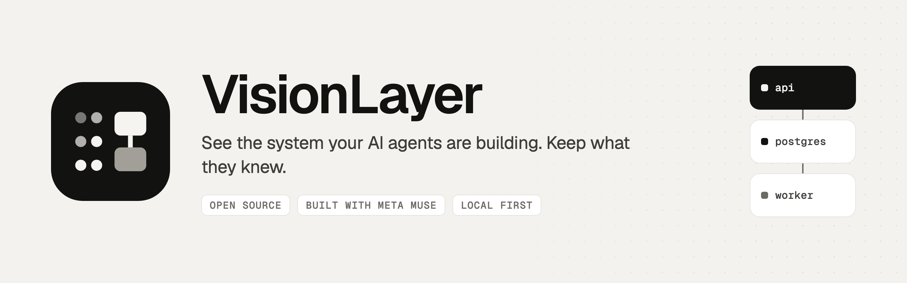
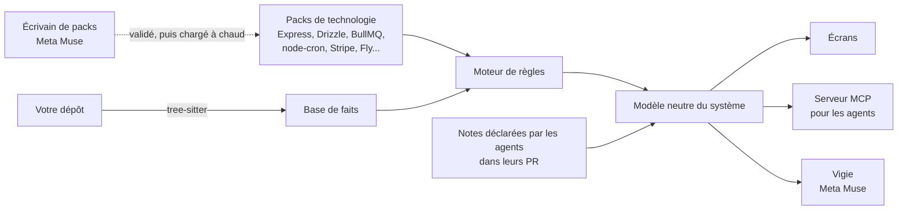

<p align="center">
  <picture>
    <source media="(prefers-color-scheme: dark)" srcset="assets/banner-dark.png">
    
  </picture>
</p>

<p align="center"><sub><a href="README.md">Read in English</a></sub></p>

<br>

Les agents de code écrivent maintenant la plus grande partie de notre code, et ils l'écrivent bien. Relire chaque ligne n'est plus le travail. **Comprendre le système, si.** VisionLayer lit votre dépôt, sans aucun modèle de langage, et montre le système tel qu'il tourne : qui peut appeler quoi, qui écrit dans quelle table, ce qui démarre à 3 h du matin. Chaque fait cite son fichier et sa ligne. Ensuite, il garde ce que vos agents savaient en écrivant le code, et vous permet de vous mesurer aux vrais problèmes qu'ils ont rencontrés.

## Le problème

Quand les agents écrivent le code, quatre choses se perdent sans bruit.

| | Ce qui se perd | À quoi ça ressemble |
|---|---|---|
| **1** | **Le système devient une boîte noire** | Personne ne sait plus dire qui peut appeler quoi, ce qui tourne tout seul, ni qui écrit dans une table. La réponse est dans le code, dispersée dans des dizaines de fichiers. |
| **2** | **Ce que l'agent savait meurt avec sa session** | Pourquoi il a choisi cette solution, la panne qu'il a rencontrée, la règle métier qu'il devait suivre. Relire le code plus tard ne le ramène jamais. |
| **3** | **Les décisions se prennent à l'aveugle** | Faut-il fusionner cette PR ? Touche-t-elle aux paiements ? Le README dit-il encore vrai ? Sans vue du système, on décide sur la confiance. |
| **4** | **L'ingénieur perd la main** | Quand l'agent résout tous les problèmes difficiles, l'ingénieur ne les résout plus. Le jour où l'agent se trompe, plus personne n'a l'instinct de le voir. |

## Ce que fait VisionLayer

**Zoomer du système entier jusqu'à une ligne.** On part de ce qui tourne et de ce qui appelle quoi. On descend niveau par niveau, et on ouvre le code exact à la fin.

| Niveau | La question à laquelle il répond |
|---|---|
| Système | De quoi est-il fait, et qu'est-ce qui appelle quoi ? |
| Un bloc | Que contient ce service, ce worker, cette base ? |
| Une question transversale | Qui peut entrer ? Qui écrit cette table ? Qu'est-ce qui tourne sans clic ? |
| Une feature | Que se passe-t-il, étape par étape, quand un client paie ? |
| Une fonction, une ligne | Quel code fait exactement cela ? |

**Lire l'algorithme quand il le faut.** Une feature est tracée dans l'ordre où le code l'exécute : la route, la garde, la lecture en base, l'écriture, le message mis en file. Chaque étape ouvre sa ligne.

**Décider sur des faits.** VisionLayer montre ce qui mérite qu'on aille voir, et dit comment il l'a trouvé. Ce qu'il ne sait pas lire est marqué *non lu*, jamais *sûr*.

**Garder ce que savent les agents.** Les agents reçoivent un contrat court : lire la carte avant la tâche, déclarer dans la PR ce que le code ne dit pas. Chaque note est ancrée sur la fonction qu'elle explique, et revérifiée contre le code à chaque changement : *vérifiée*, *périmée* ou *contredite*. Les notes apparaissent là où elles expliquent quelque chose, pas dans un wiki à part.

**Donner la carte aux agents plutôt que de les laisser relire.** Le même modèle est servi aux agents de code par MCP. Le déroulé complet d'une feature coûte environ **1 250 tokens au lieu de 6 600** pour lire le fichier, et il arrive avec ce que les agents précédents ont déclaré.

## Ce qu'il a trouvé dans une vraie application

atelier-api est une vraie application Express, Postgres et Stripe qui nous sert de terrain d'essai. VisionLayer a signalé tout ceci en lisant le code, sans aucun modèle de langage :

| Constat | Où |
|---|---|
| `GET /admin/export` envoie l'email, le nom et le téléphone de tous les clients à **toute personne connectée** : le chemin dit admin, la route ne vérifie qu'une session | `admin/export.ts:8` |
| Le remboursement exige le rôle admin, mais **aucun code ne l'écrit jamais** | `schema.ts:15`, `refund.ts:12` |
| Les 3 tâches planifiées tournent dans l'API, qui garde 2 machines allumées : **chaque tâche s'exécute deux fois** | `jobs/index.ts:13`, `fly.toml` |
| `expireHolds` lit les réservations en attente, puis les annule **sans revérifier leur état**, alors que le webhook Stripe écrit les mêmes lignes | `jobs/expire.ts:13`, `jobs/expire.ts:19`, `bookings/confirm.ts:28` |
| Le corps entier de l'inscription, **mot de passe compris, est écrit dans les journaux** | `auth/signup.ts:19` |
| Une réservation est écrite, puis son email est mis en file **hors de la transaction** : si la mise en file échoue, l'écriture reste | `bookings/create.ts:28`, `bookings/create.ts:39` |
| Les connexions à Postgres et à Redis n'ont **aucun délai maximum** : si l'une ne répond plus, les requêtes attendent sans fin | `db.ts:6`, `queue.ts:7` |

## Construit avec Meta

La carte ne vient jamais d'un modèle. Elle vient des packs de technologie, qui lisent le code de façon déterministe, ou de ce que les agents ont déclaré. Les modèles de Meta font ce que les modèles font bien, dans ces limites.

| | Modèle | Ce qu'il fait |
|---|---|---|
| **L'écrivain de packs** | Muse Spark 1.3, API Responses | Quand VisionLayer rencontre une technologie qu'il ne sait pas lire, Muse écrit le pack manquant à partir de la documentation de cette technologie, jamais de votre projet : l'inventaire des formes de l'API, un test par forme, puis les règles. VisionLayer le valide à part, le charge à chaud, et le retirer rend exactement la carte d'avant. |
| **Vigie** | Muse Spark 1.3, et un modèle ouvert de Meta servi par Baseten | On pose une question depuis n'importe quel écran. Vigie répond par les outils de VisionLayer, cite les lignes derrière chaque point, et dit *non lu* au lieu de deviner. |
| **L'entraîneur des Replays** | Muse Spark 1.3 | Pose des questions et donne des indices gradués. Ne donne jamais la réponse, ne montre jamais la solution de l'agent. |
| **L'agent de code du projet** | Muse Code | Code dans le projet, lit la carte par MCP avant sa tâche, et déclare ce qu'il a fait dans sa PR. |

## Replays : garder la main sur son propre système


Les vrais problèmes que les agents ont rencontrés dans votre projet deviennent des défis jouables, toujours facultatifs. On reçoit le code tel qu'il était avant le correctif, avec le test qui échoue. On cherche. Bolt, le visage robot de Vigie, vous entraîne par des questions et trois indices gradués, du plus vague au plus précis, sans jamais donner la réponse. Une fois les tests verts, on compare sa solution à celle de l'agent, côte à côte, sans gagnant : chacune montre ce que l'autre a vu ou raté. Si la vôtre attrape un cas que celle de l'agent ratait, proposez-la au projet.

Ce ne sont pas des exercices inventés. Sur atelier-api, le premier Replay est une course entre une tâche planifiée et le webhook Stripe : une réservation payée, puis annulée par la tâche passée juste avant.

## État

VisionLayer se construit en public pendant le hackathon. Cette section dit ce qui marche aujourd'hui, et ce qui ne marche pas encore.

| Partie | État |
|---|---|
| Moteur de lecture, packs, modèle neutre, constats | Marche aujourd'hui, couvert par 255 tests |
| Serveur MCP pour les agents, crochets d'activité | Marche aujourd'hui |
| Couche de connaissance : notes ancrées au code, vérifiées à chaque changement | Marche aujourd'hui |
| Interface locale | En construction : l'ancienne est retirée, `pnpm ui` sert l'API de la carte |
| Écrivain de packs avec Muse Spark | Marche aujourd'hui (`pnpm packs`) |
| Vigie sur la Model API et sur Baseten | En construction |
| Replays avec Vigie en entraîneur | En construction |

Les captures d'écran seront ajoutées quand chaque partie tournera pour de vrai.

## Comment ça marche



- **Des faits, pas des suppositions.** tree-sitter transforme le TypeScript et le JavaScript en faits. Les packs, écrits en YAML, décrivent chacun le comportement documenté d'une technologie, et sont testés forme par forme.
- **Un seul modèle pour toutes les piles.** Les règles assemblent un modèle neutre : blocs déployables, points d'entrée, déroulés entre fonctions, gardes d'accès, lectures et écritures de données, constats et couverture.
- **Honnête sur ce qui manque.** Ce qui n'est pas lu est marqué *non lu*. Une technologie sans pack est marquée *sans pack*, et c'est exactement ce que l'écrivain de packs corrige.
- **Tout en local.** Rien ne quitte votre machine, sauf une question posée à Vigie et les extraits qu'il cite. Avec un modèle ouvert, rien ne part du tout.

## Démarrage rapide

```bash
git clone https://github.com/mouhamedsylla/visionlayer && cd visionlayer
pnpm install
```

Lire l'exemple fourni, puis votre propre projet :

```bash
pnpm facts tests/corpus/atelier-api
```

```bash
pnpm ui /chemin/vers/votre/projet
```

`pnpm ui` sert l'API de la carte sur `http://127.0.0.1:4173` ; la nouvelle interface est en construction. Les tests se lancent avec `pnpm test`.

### Relier vos agents de code

Donnez-leur la carte par MCP, en ajoutant ce serveur à la configuration de votre agent :

```json
{ "mcpServers": { "visionlayer": { "command": "pnpm", "args": ["--dir", "/chemin/vers/visionlayer", "mcp"] } } }
```

Les outils sont `vision_summary`, `vision_slice`, `vision_reach` et `vision_source`.

## Construit avant et pendant le hackathon

VisionLayer est construit pour le Meta AI Developer Hackathon, parcours Startup, sur un moteur qui existait avant. Le premier commit de ce dépôt est ce moteur, tel qu'il était le 26 octobre 2026. Tout ce qui suit a été construit pendant le hackathon.

| Avant le 27 octobre | Pendant le hackathon |
|---|---|
| Le moteur de lecture : tree-sitter, moteur de règles, packs de technologie | L'écrivain de packs avec Muse Spark, chargement et retrait à chaud |
| Le modèle neutre du système et la couche de connaissance | Vigie, sur la Model API et sur Baseten |
| Le serveur MCP et le contexte réduit des agents | Les Replays, avec Vigie en entraîneur |
| Les crochets d'activité des agents | Muse Code comme agent du projet |
| L'ancienne interface | La nouvelle interface et ses écrans |

## Ce que ce n'est pas

- **Pas un agent.** Il n'écrit jamais votre code, ne lance aucun agent, ne fusionne jamais rien.
- **Pas un relecteur ligne à ligne.** Il montre où regarder ; la revue reste la vôtre.
- **Pas une documentation générée.** Une documentation générée se périme et peut mentir. Ici, tout est lu ou déclaré, puis vérifié.

## Les limites, honnêtement

- **Une pile couverte, pas toutes.** TypeScript et JavaScript ; Express, Drizzle et Postgres, BullMQ, node-cron, Stripe, Docker, Fly. Ailleurs, VisionLayer dit *sans pack*.
- **Le code, pas la production.** Il lit ce que le code et la configuration déclarent. Ce qui s'est réellement exécuté n'est pas lu.

## Le dépôt

```
cli/            les commandes : ui, scan, inspect, context, knowledge, hook, mcp
vision/         le moteur : analyseurs, base de faits, packs, règles, modèle neutre, connaissance, serveur web
integrations/   le serveur MCP pour les agents de code
tests/          les tests, les fixtures, et atelier-api, l'application d'exemple
docs/           le fonctionnement de VisionLayer, les décisions (ADR), comment lire chaque écran
```

## Licence

Apache 2.0. Construit à Dakar par RYPHA.
