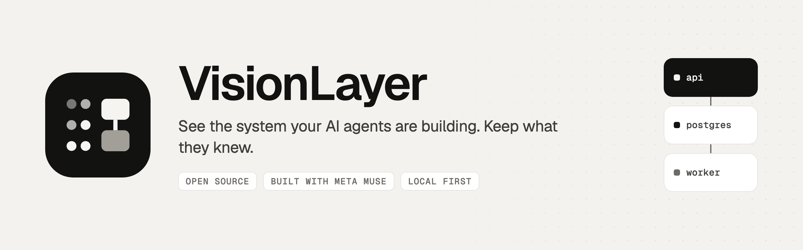
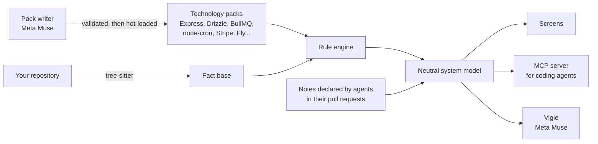

<p align="center">
  <picture>
    <source media="(prefers-color-scheme: dark)" srcset="assets/banner-dark.png">
    
  </picture>
</p>

<p align="center">
  <a href="LICENSE"></a>
  
  
  
  
</p>

<p align="center">
  <a href="#the-problem">The problem</a> &nbsp;&nbsp;
  <a href="#what-visionlayer-does">What it does</a> &nbsp;&nbsp;
  <a href="#what-it-found-in-a-real-app">What it found</a> &nbsp;&nbsp;
  <a href="#replays-stay-sharp-on-your-own-system">Replays</a> &nbsp;&nbsp;
  <a href="#quick-start">Quick start</a> &nbsp;&nbsp;
  <a href="#status">Status</a> &nbsp;&nbsp;
  <a href="#built-before-and-during-the-hackathon">Before and during the hackathon</a>
</p>

<p align="center"><sub><a href="README.fr.md">Lire en français</a></sub></p>

<br>

AI coding agents now write most of our code, and they write it well. Reading every line is no longer the job. **Understanding the system is.** VisionLayer reads your repository, without any language model, and shows the system as it actually runs: who can call what, who writes which table, what starts at 3 a.m. Every fact cites its file and line. Then it keeps what your agents knew while they wrote it, and lets you test yourself against the real problems they hit.

## The problem

When agents write the code, four things quietly get lost.

| | What gets lost | What it looks like |
|---|---|---|
| **1** | **The system becomes a black box** | Nobody can say who can call what, what runs on a schedule, or who writes to a table. The answer is in the code, scattered across dozens of files. |
| **2** | **What the agent knew dies with its session** | Why it chose this approach, the failure it ran into, the business rule it had to follow. Reading the code later never brings that back. |
| **3** | **Decisions are made blind** | Should this PR be merged? Does it touch payments? Is the README still true? Without a view of the system, you decide on trust. |
| **4** | **Engineers lose their edge** | When the agent solves every hard problem, the engineer stops solving them. The day the agent is wrong, nobody has the instinct to notice. |

## What VisionLayer does

**Zoom from the whole system down to a single line.** Start with what runs and what calls what. Go down level by level, and open the exact code at the end.

| Level | The question it answers |
|---|---|
| System | What is it made of, and what calls what? |
| A block | What is inside this service, this worker, this database? |
| A cross-cutting question | Who can enter? Who writes this table? What runs without a click? |
| A feature | What happens, step by step, when a customer pays? |
| A function, a line | Which code does exactly that? |

**Read the algorithm when it matters.** A feature is traced in the order the code runs it: the route, the guard, the database read, the write, the message put on a queue. Every step opens its line.

**Decide on facts.** VisionLayer points to what deserves a look, and says how it found it. What it cannot read is marked *not read*, never *safe*.

**Keep what agents know.** Agents get a short contract: read the map before a task, declare what the code does not say in the pull request. Each note is anchored to the function it explains and re-checked against the code on every change: *verified*, *stale* or *contradicted*. Notes appear right where they explain something, not in a separate wiki.

**Give agents the map instead of letting them reread.** The same model is served to coding agents over MCP. A feature's full flow costs about **1,250 tokens instead of 6,600** to read the file, and comes with what earlier agents declared.

## What it found in a real app

atelier-api is a real Express, Postgres and Stripe application we use as a test bed. VisionLayer reported all of this by reading the code, with no language model involved:

| Finding | Where |
|---|---|
| `GET /admin/export` sends every customer's email, name and phone to **any signed-in user**: the path says admin, the route only checks a session | `admin/export.ts:8` |
| Refunds require the admin role, but **no code ever writes it** | `schema.ts:15`, `refund.ts:12` |
| The 3 scheduled jobs run inside the API, which keeps 2 machines up: **each job runs twice** | `jobs/index.ts:13`, `fly.toml` |
| `expireHolds` reads pending bookings, then cancels them **without checking their state again**, while the Stripe webhook writes the same rows | `jobs/expire.ts:13`, `jobs/expire.ts:19`, `bookings/confirm.ts:28` |
| The whole signup request body, **password included, is written to the logs** | `auth/signup.ts:19` |
| A booking is written, then its email is queued **outside the transaction**: if queuing fails, the write stays | `bookings/create.ts:28`, `bookings/create.ts:39` |
| The connections to Postgres and Redis have **no timeout**: if either stops answering, requests wait forever | `db.ts:6`, `queue.ts:7` |

## Tested on projects it had never seen

**[Open the read-only demo](https://mouhamedsylla.github.io/visionlayer/)**: what the engine returned for two of these projects, frozen as it was. Actions that need execution (free questions to Vigie, writing a pack, playing a Replay) run when you start VisionLayer on your own project.

A tool that only works on the project it was tuned on is useless. So we drew 11 public Express projects at random, ran the engine with **no change to its code** at measure time, and compared it with an independent count of their sources.

| Project | Routes (engine / source) | Tables | Routes whose flow shows an effect |
|---|---|---|---|
| [mini-erp-crm](https://github.com/Rahul03ll/mini-erp-crm) | 20 / 20 | 7 / 7 | 19 / 20 |
| [school-management-system](https://github.com/wedbata/school-management-system) | 42 / 42 | 13 / 13 | 41 / 42 |
| [Barbershop-Booking-System](https://github.com/MrTabaOfficial/Barbershop-Booking-System) | 33 / 33 | 8 / 8 | 30 / 33, plus 4 scheduled jobs |
| kanban-fullstack | 12 / 12 | 4 / 4 | 11 / 12 |

7 of the 11 read well. 2 revealed general defects, since fixed and then re-measured. Interfaces injected into controllers stay unread, and a very large multi-app repository was inconclusive. We re-read 12 random routes against their code and found one wrong guard, also fixed. Each fix targets a general form, with its own test, never one project.

**The whole loop, on a project it had never seen (mini-erp-crm).** VisionLayer flags a read outside a transaction on `POST /challans/:id/confirm`. Muse Code reads the map before writing, fixes the double stock decrement with a conditional write, and adds a test. Its session appears, its rules are checked against the code, the finding disappears, and the fix becomes a Replay. **Vigie**, on Barbershop-Booking-System, answered 12 runs of 8 questions with 104 citations that all exist; on p95 latency it answered *not read*.

## Agent context: what we measured

We shrink what an agent has to read, and we measure it instead of assuming it.

| Measure | Result |
|---|---|
| One feature's full flow, on atelier-api | about **1,250 tokens instead of 6,600** to read the file |
| Same task on atelier-api, 5 runs | **23% cheaper**, 12% fewer model calls, 10% fewer tokens read |
| 8 real fixes on OpenArchiver, 31 runs | searches before the first edit fall from **11.5 to 7.6**, but **no saving overall**: median cost $0.58 with VisionLayer, $0.43 without, and fixes of the same quality |

The large test is the honest one. Pouring a map into an agent's window you do not control can cost more than it saves. The model bills mostly for what it rereads on each call, and the agent's own base weighs 29,000 tokens per call. The map helps it find its way; it does not yet make runs cheaper on large repositories. Public benchmarks (SWE-PolyBench, Agent Retrieval Bench) were not run.

## Built with Meta

The map never comes from a model. It comes from technology packs that read the code deterministically, or from what agents declared. Meta's models do what models are good at, inside those limits.

| | Model | What it does |
|---|---|---|
| **The pack writer** | Muse Spark 1.3, Responses API | When VisionLayer meets a technology it cannot read, Muse writes the missing pack from that technology's documentation, never from your project: an inventory of the API's forms, one test per form, then the rules. VisionLayer validates it in isolation, hot-loads it, and removing it restores the exact previous map. |
| **Vigie** | Muse Spark 1.3, and an open Meta model served by Baseten | Ask a question from any screen. Vigie answers through VisionLayer's own tools, cites the lines behind each point, and says *not read* instead of guessing. |
| **The Replay coach** | Muse Spark 1.3 | Asks questions and gives graded hints. Never gives the answer, never shows the agent's fix. |
| **The project's coding agent** | Muse Code | Codes in the project, reads the map over MCP before its task, and declares what it did in its pull request. |

## Replays: stay sharp on your own system


The real problems agents ran into in your project become optional, playable challenges. You get the code as it was before the fix, with the failing test. You dig in. Bolt, Vigie's robot face, coaches you with questions and three graded hints, from vague to precise, without ever giving the answer. Once your tests pass, you compare your fix with the agent's, side by side, with no winner: each one shows what the other saw or missed. If yours catches a case the agent's missed, propose it to the project.

These are not made-up exercises. On atelier-api, the first Replay is a race between a scheduled job and a Stripe webhook: a booking paid for, then cancelled by the job that ran a moment before.

## Status

VisionLayer is being built in the open during the hackathon. This section says what runs today and what does not yet.

| Part | Status |
|---|---|
| Reading engine, packs, neutral model, findings | Works today, covered by 307 tests |
| MCP server for coding agents, activity hooks | Works today |
| Knowledge layer: notes anchored to code, checked on every change | Works today |
| Local interface | Being built: the previous one is removed, `pnpm ui` serves the map API |
| Pack writer with Muse Spark | Works today (`pnpm packs`) |
| Vigie on the Model API and on Baseten | Being built |
| Replays with Vigie as coach | Being built |

Screenshots will be added once each part runs for real.

## How it works



- **Facts, not guesses.** tree-sitter parses TypeScript and JavaScript into facts. Packs, written in YAML, encode the documented behaviour of one technology each, and are tested form by form.
- **One model for every stack.** The rules assemble a stack-neutral model: deployable blocks, entry points, flows across functions, access guards, data reads and writes, findings and coverage.
- **Honest about gaps.** Anything not read is shown as *not read*. A technology without a pack is shown as *no pack*, which is exactly what the pack writer fixes.
- **Local first.** Nothing leaves your machine, except a question to Vigie and the excerpts it cites. With an open model, nothing leaves at all.

## Quick start

```bash
git clone https://github.com/mouhamedsylla/visionlayer && cd visionlayer
pnpm install
```

Read the bundled example, then your own project:

```bash
pnpm facts tests/corpus/atelier-api
```

```bash
pnpm ui /path/to/your/project
```

`pnpm ui` serves the map API on `http://127.0.0.1:4173`; the new interface is being built. Run the tests with `pnpm test`.

### Connect your coding agents

Give them the map over MCP, by adding this server to your agent's configuration:

```json
{ "mcpServers": { "visionlayer": { "command": "pnpm", "args": ["--dir", "/path/to/visionlayer", "mcp"] } } }
```

The tools are `vision_summary`, `vision_slice`, `vision_reach` and `vision_source`.

## Built before and during the hackathon

VisionLayer is built for the Meta AI Developer Hackathon, Startup track, on top of an engine that existed before it. The first commit of this repository is that engine, as it stood on October 26, 2026. Everything after it was built during the hackathon.

| Before October 27 | During the hackathon |
|---|---|
| The reading engine: tree-sitter, rule engine, technology packs | The pack writer with Muse Spark, hot loading and unloading |
| The neutral system model and the knowledge layer | Vigie, on the Model API and on Baseten |
| The MCP server and the reduced agent context | Replays, with Vigie as coach |
| Activity hooks for coding agents | Muse Code as the project's agent |
| The previous interface | The new interface and its screens |

## What it is not

- **Not an agent.** It never writes your code, never launches an agent, never merges anything.
- **Not a line-by-line reviewer.** It shows where to look; review stays yours.
- **Not generated documentation.** Generated docs go stale and can lie. Here, everything is read or declared, then checked.

## Limits, honestly

- **Static reading.** A protection that exists is not proof that it is enough. Concurrency, OpenAPI, GraphQL, gRPC and libraries with no running program are not represented yet.
- **Replays trust the agent's test.** A solution can pass it while the route still calls the old code.
- **One stack covered, not every stack.** TypeScript and JavaScript; Express, Drizzle and Postgres, BullMQ, node-cron, Stripe, Docker, Fly. Elsewhere VisionLayer says *no pack*.
- **The code, not production.** It reads what code and configuration declare. What actually ran is not read.

## Repository

```
cli/            command-line entry points: ui, scan, inspect, context, knowledge, hook, mcp
vision/         the engine: parsers, fact base, packs, rules, neutral model, knowledge, web server
integrations/   the MCP server for coding agents
tests/          tests, fixtures, and atelier-api, the example application
docs/           how VisionLayer works, decisions (ADRs), how to read each view (in French)
```

## License

Apache 2.0. Built in Dakar by RYPHA.
