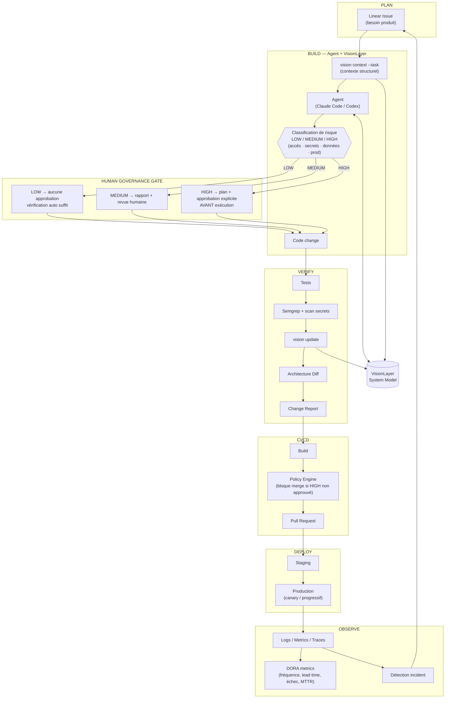

# RYPHA Agentic Software Engineering Workflow
## Spécification technique maîtresse — structure, mécanisme, conformité gouvernance

**Statut :** Document maître de l'implémentation technique.
**Remplace :** les sections 19 et 20 de [vision-layer-concept.md](./vision-layer-concept.md) (gouvernance ad hoc), désormais définies dans [../../governance/RYPHA_Governance_and_Standards_Framework.md](../../governance/RYPHA_Governance_and_Standards_Framework.md).
**Principe :** *Agent-executed, human-governed, standards-aligned.*

---

## 1. Ce que ce document couvre

Le document [vision-layer-concept.md](./vision-layer-concept.md) décrit le **concept** de VisionLayer et du workflow (pourquoi, quoi). Ce document décrit :

1. Le **mécanisme complet**, de bout en bout, avec un diagramme unique.
2. La **structure physique** de l'implémentation.
3. La **conformité explicite** de chaque étape au référentiel de gouvernance (NIST SSDF, NIST AI RMF, classification de risque, DORA) — pas une déclaration vague, une correspondance ligne à ligne.

Rien ici ne remplace la compréhension conceptuelle acquise dans `vision-layer-concept.md` et dans les notes d'apprentissage de gouvernance — ce document suppose que ces deux bases sont déjà maîtrisées.

---

## 2. Mécanisme complet — diagramme

Ce diagramme intègre trois choses que les versions précédentes traitaient séparément : le flux d'ingénierie, les points de vérification technique, et les points de gouvernance humaine (au lieu de laisser la gouvernance "en fin de roadmap").



**Ce que ce diagramme corrige par rapport à la version conceptuelle initiale** : la gouvernance humaine (bloc `GATE`) n'est plus une couche optionnelle ajoutée en fin de roadmap — elle est **structurellement entre l'agent et le code**, avant même la vérification technique. Un changement HIGH ne produit pas de code sans approbation préalable, quel que soit l'état d'avancement de VisionLayer.

---

## 3. Structure physique

```text
rypha-fabric/
│
├── governance/                          # Gouvernance — indépendante de l'implémentation
│   ├── RYPHA_Governance_and_Standards_Framework.md
│   └── RYPHA_Governance_Learning_Notes.md
│
└── workflow/                            # Implémentation technique du workflow
    │
    ├── docs/
    │   ├── vision-layer-concept.md      # Concept VisionLayer (existant)
    │   ├── architecture.md              # Ce document — mécanisme + conformité
    │   └── decisions/                   # ADR — une décision technique = un fichier
    │
    ├── vision/                          # VisionLayer — implémentation
    │   ├── scanner/                     # Découverte du repository
    │   ├── parsers/                     # AST / extraction syntaxique
    │   ├── extractor/                   # Construction des relations (Facts)
    │   ├── model/                       # System Model (faits + interprétations)
    │   ├── graph/                       # Génération Mermaid / JSON
    │   ├── context/                     # Agent Context (vision context --task)
    │   ├── diff/                        # Architecture Diff
    │   └── report/                      # Change Report
    │
    ├── cli/                             # CLI vision (init, scan, inspect, context, update, diff, report)
    │
    ├── integrations/
    │   ├── git/                         # Lecture commits/branches/diff
    │   ├── linear/                      # Traçabilité issue ↔ agent ↔ PR
    │   ├── semgrep/                     # Règles statiques + secrets
    │   └── agents/                      # Interface agent (MCP / skill / API)
    │
    ├── schemas/                         # JSON Schema du System Model, AgentContext, ChangeReport
    ├── policies/                        # Policy Engine — YAML des règles HIGH/MEDIUM/LOW (implémentation de governance §6)
    ├── examples/                        # Cas d'usage réels (ex. Nafar)
    └── tests/                           # Tests de VisionLayer lui-même (voir §6.4)
```

---

## 4. Conformité au référentiel de gouvernance — correspondance explicite

Cette table est le cœur de ce document : chaque brique technique référence la pratique ou le contrôle de gouvernance qu'elle met en œuvre. Sans cette table, VisionLayer est juste un outil ; avec elle, c'est la preuve que le workflow *applique* le référentiel, pas seulement qu'il le cite.

### 4.1 Vis-à-vis de NIST SSDF

| Groupe SSDF | Pratique | Implémentation technique |
|---|---|---|
| **PO** (Prepare the Organization) | Définir les exigences de sécurité avant le développement | `vision context --task` fournit les contraintes connues (ex. "token single-use") avant que l'agent écrive du code |
| **PS** (Protect Software) | Protéger le code contre accès non autorisé/falsification | `integrations/git` + branch protection + `policies/` (CODEOWNERS sur chemins HIGH) |
| **PW** (Produce Well-Secured Software) | Revue de code, tests, configuration sécurisée par défaut | Bloc `VERIFY` du diagramme (Tests, Semgrep, vision update) |
| **PW** | Réutiliser du logiciel existant plutôt que dupliquer | Principe directeur du choix d'outils (ex. tree-sitter plutôt que parsers maison — voir §6) |
| **RV** (Respond to Vulnerabilities) | Identifier, prioriser, corriger | `OBSERVE` → `INCIDENT` → nouvelle Linear Issue (boucle complète du diagramme) |

### 4.2 Vis-à-vis de la classification de risque (governance §6)

| Niveau | Déclencheur technique | Mécanisme d'application |
|---|---|---|
| LOW | Aucun chemin HIGH touché, pas de dépendance nouvelle | `policies/` laisse passer, vérification automatique suffit |
| MEDIUM | Logique métier modifiée, nouvelle dépendance | Policy Engine exige un rapport (`vision report`) + revue humaine avant merge, sans bloquer le merge automatiquement |
| HIGH | Chemin listé dans `policies/high-risk-paths.yaml` (auth, secrets, migrations, IaC, paiement) | Policy Engine **bloque le merge** jusqu'à approbation explicite enregistrée (pas une simple revue passive) |

Exemple concret de règle (`workflow/policies/high-risk-paths.yaml`) :

```yaml
high_risk_paths:
  - "**/auth/**"
  - "**/payments/**"
  - "**/migrations/**"
  - "**/infra/**"
  - "**/secrets/**"
require_explicit_approval: true
block_merge_until_approved: true
```

### 4.3 Vis-à-vis de NIST AI RMF

| Fonction AI RMF | Implémentation |
|---|---|
| **Govern** | `policies/` définit qui approuve quoi ; le référentiel de gouvernance assigne CTO/CEO (voir governance framework) |
| **Map** | VisionLayer — le System Model cartographie où les agents interviennent et quels composants ils affectent |
| **Measure** | DORA metrics (bloc `OBSERVE`) + taux de changements HIGH effectivement approuvés avant merge |
| **Manage** | Boucle `INCIDENT → Linear Issue` — un problème de production redevient une tâche d'ingénierie tracée |

**Rappel important** (déjà noté dans les notes d'apprentissage) : ce tableau couvre les agents du **cycle de développement**. Le tuteur IA de Nafar, en tant que système IA en production face aux élèves, nécessite sa **propre** application de NIST AI RMF — hors périmètre de ce document technique, à traiter dans la gouvernance produit de Nafar.

### 4.4 Vis-à-vis de DORA metrics

| Métrique | Où elle est mesurée dans le pipeline |
|---|---|
| Fréquence de déploiement | Bloc `DEPLOY` — horodatage de chaque passage en production |
| Lead time for changes | Delta entre `LIN` (création issue) et `PROD` (déploiement) |
| Change failure rate | Ratio `INCIDENT` / nombre total de déploiements sur une période |
| MTTR | Delta entre `INCIDENT` (détection) et le déploiement du correctif |

---

## 5. Ordre d'implémentation révisé

**Détail périmètre par périmètre (MVP0-5) : voir mvp-roadmap.md** — scope exact, livrable, cas de test, et gouvernance applicable à chaque étape, avant tout contact avec Nafar.

La roadmap initiale (`vision-layer-concept.md` §37) plaçait la gouvernance et Semgrep/CI en fin de séquence (étapes 9, 13). C'est corrigé ici : **la gouvernance minimale doit exister avant même le MVP0 de VisionLayer**, parce qu'elle ne dépend pas de VisionLayer pour fonctionner (c'est du process, pas du code).

```text
0. Gouvernance minimale (déjà rédigée) — branch protection, policies/high-risk-paths.yaml
        ↓
1. Repository scanner
        ↓
2. Symbol / dependency extraction
        ↓
3. Internal graph model
        ↓
4. Mermaid generation
        ↓
5. CLI inspection
        ↓
6. Source navigation
        ↓
7. Agent context
        ↓
8. Git integration
        ↓
9. Architecture diff
        ↓
10. Change report
        ↓
11. Agent Skill / MCP
        ↓
12. Linear integration
        ↓
13. Semgrep + CI + Policy Engine (bloque HIGH sans approbation)
        ↓
14. DORA metrics instrumentées
        ↓
15. Cloud + déploiement progressif
        ↓
16. Observability + boucle incident → Linear
```

L'étape 0 se fait cette semaine, sans écrire une ligne de code de VisionLayer — c'est de la configuration GitHub/GitLab et un fichier YAML.

---

## 6. Décisions techniques — actées

| # | Décision | Choix | ADR |
|---|---|---|---|
| 1 | Langage d'implémentation | TypeScript | [0001](./decisions/0001-implementation-language.md) |
| 2 | Stratégie de parsing | `tree-sitter` (pas de parsers maison) | [0002](./decisions/0002-parsing-strategy.md) |
| 3 | Stockage du System Model | Fichiers JSON locaux pour le MVP | [0003](./decisions/0003-model-storage-format.md) |
| 4 | Stratégie de test | Corpus de repositories de test + golden files, alimenté en continu | [0004](./decisions/0004-testing-strategy.md) |

Le MVP0 (repository scanner) n'a plus de décision bloquante en attente.

---

## 7. Prochaine étape

Les pistes A et B qui figuraient ici sont dépassées : le MVP0 et les périmètres suivants sont livrés (voir mvp-roadmap.md). La suite du travail, son ordre et ses raisons sont dans feuille-de-route.md ; chaque étape y est un ticket du projet Rypha-Fabric dans Linear, qui fait foi pour l'avancement.
