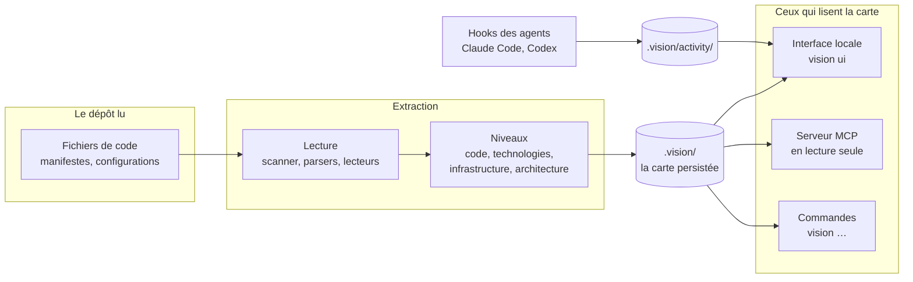

# 1. Vue d'ensemble

VisionLayer lit un dépôt de code et en tire une carte du système : ce qui s'exécute, par où on y entre, ce qui est stocké, qui parle à qui. Chaque élément de la carte renvoie à la ligne qui le prouve. La carte est lue par deux publics : un humain, dans une interface locale, et un agent de code, par un serveur MCP.

VisionLayer n'est pas un agent : il ne comprend pas un texte et ne devine rien. C'est un programme déterministe : les mêmes fichiers donnent la même carte.

## Les parties

| Partie | Rôle | Code |
|---|---|---|
| **Lecture** | liste les fichiers du dépôt, analyse le code avec tree-sitter, lit les manifestes | `vision/scanner`, `vision/parsers`, `vision/extractor`, `vision/facts` |
| **Niveaux** | construisent chacun une vue : structure du code, technologies, infrastructure, architecture | `vision/model`, `vision/stack`, `vision/infra`, `vision/arch` |
| **La carte persistée** | les fichiers de `.vision/`, écrits par `scan` et `update` | `vision/*/store.ts` |
| **Interface** | serveur HTTP local et écrans ; ne lit que la carte v2, et ne la recalcule que sur un clic | `vision/web`, `ui/` |
| **Serveur MCP** | donne la carte aux agents, en lecture seule | `integrations/agents/server.ts` |
| **Activité** | reçoit des hooks des agents les fichiers qu'une session a modifiés et ses compteurs de tokens | `vision/activity` |
| **Connaissance** | lit les affirmations que les agents écrivent dans le dépôt, ancrées au code | `vision/knowledge` |

## Ce que VisionLayer écrit

VisionLayer n'écrit que dans `.vision/`, à la racine du dépôt lu ([ADR 0009](../decisions/0009-ui-human-triggered-actions.md)). Une seule exception : à la création d'un projet, il écrit une fois les fichiers que l'humain a validés ([ADR 0016](../decisions/0016-creation-d-un-projet.md)).

| Fichier | Contenu | Écrit par |
|---|---|---|
| `model.json` | fichiers, symboles, imports, ré-exports | `scan`, `update` |
| `graph.mmd` | le graphe des imports, en Mermaid | `scan`, `update` |
| `stack.json` | les technologies, chacune avec sa preuve | `scan`, `update` |
| `infra.json` | composants et liens d'infrastructure | `scan`, `update` |
| `architecture.json` | la carte d'exécution, version 1 ([ADR 0012](../decisions/0012-runtime-architecture-and-feature-flows.md)) | `scan`, `update` |
| `*.previous.json` | la version d'avant, pour comparer | `update` |
| `facts.json` | les faits de chaque fichier, pour ne relire que ce qui change (chapitre 2) | `facts` |
| `activity/` | le journal des sessions d'agents ; s'ignore lui-même dans git | les hooks |

Les commandes qui écrivent sont lancées par un humain : en ligne de commande, ou par un bouton de l'interface. Côté interface, toute écriture passe par une requête `POST` ; une lecture est un `GET` (`vision/web/server.ts`). Le serveur MCP ne peut rien écrire : ses outils ne font que lire la carte.

## Ce que VisionLayer ne lit jamais

- Un fichier `.env` n'est ni lu ni ouvert, par aucune partie. Une variable d'environnement apparaît par son **nom** et par l'endroit où le code la lit, jamais par sa valeur.
- Aucune lecture ne sort du dépôt (`vision/model/paths.ts`).
- Git est lu localement, avec des arguments en tableau, jamais par une chaîne passée à un shell ; jamais de remote ni de jeton ([ADR 0006](../decisions/0006-git-integration-stays-local.md)).
- Le journal d'activité ne garde ni le texte d'un prompt, ni une commande, ni le contenu d'un fichier : seulement l'événement, l'outil, les chemins modifiés et des compteurs.

## La carte d'architecture, et le code qui part

La carte d'architecture est construite par **la base de faits et les packs** (`vision/facts`, `vision/packs`), qui produisent le **modèle neutre** ([ADR 0017](../decisions/0017-modele-neutre.md)). Rien n'y est propre à une pile : ce qu'un framework veut dire est écrit dans un pack. Les chapitres 2 à 5 le décrivent.

Le dépôt contient encore l'ancien moteur, **la carte version 1** (`vision/arch/build.ts` et `analyze.ts`), écrite en TypeScript sur Nafar et centrée sur Firebase. Ce n'est pas une seconde façon de faire : c'est du code en sursis. Il ne sert plus qu'à ce qui va être remplacé :

- `vision scan`, qui écrit encore `.vision/architecture.json` en version 1, et les commandes `archi`, `cost` et `knowledge` ;
- les déroulés de features (`flow.ts`) et les contrats (`contract.ts`), calculés à la demande. Ils doivent être refaits sur la base de faits avant que l'ancien code parte : les nouveaux écrans les montrent.

L'ancienne interface, qui lisait la version 1, est archivée depuis le 02/10 dans `archive/ui-v1/` ([ADR 0018](../decisions/0018-nouvelle-interface.md)). La nouvelle, dans `ui/` avec son serveur `vision/web/`, est recodée écran par écran à partir des maquettes du canevas « VisionLayer — tous les écrans » et ne lit que le modèle neutre. Ses premiers écrans sont la Vue d'ensemble, Architecture, Bloc, Features et Données.

Quand les écrans sont recodés et que `scan` écrit la version 2, l'ancien moteur est retiré ([ADR 0017 §8](../decisions/0017-modele-neutre.md#8-la-migration)). Le pack Firebase est en pause ([RYP-191](https://linear.app/rypha/issue/RYP-191)). Il ne bloque pas les nouveaux écrans : d'ici là, les parties Firebase de Nafar y apparaissent comme non lues.

## Les commandes

| Commande | Ce qu'elle fait |
|---|---|
| `vision scan [chemin]` | lit le dépôt et écrit `.vision/` |
| `vision update [chemin]` | pareil, en gardant la version d'avant |
| `vision diff` | compare la carte à la version d'avant |
| `vision report` | rapport de changement, avec les chemins à risque de `policies/` |
| `vision inspect <fichier>` | ce qu'un fichier définit, importe, et qui l'importe |
| `vision source <symbole>` | où un symbole est déclaré, en suivant les ré-exports |
| `vision context --task "…"` | les fichiers utiles pour une tâche, par mots-clés ([ADR 0005](../decisions/0005-agent-context-v1-deterministic-only.md)) |
| `vision stack`, `vision infra`, `vision archi` | un niveau en texte ; `archi --feature <nom>` donne le déroulé d'une feature |
| `vision facts [chemin] --score` | le modèle neutre produit par les packs, et le score face à l'oracle d'un projet de test |
| `vision cost` | le coût en tokens des features, d'après le journal d'activité |
| `vision ui [chemin]` | l'interface locale, sur la carte v2 ; « Mettre à jour l'analyse » la recalcule |
