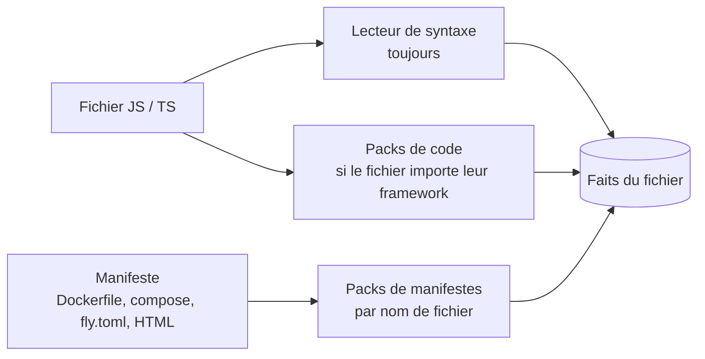

# 2. La base de faits

Code : [vision/facts/base.ts](../../vision/facts/base.ts), [vision/facts/syntax.ts](../../vision/facts/syntax.ts), [vision/facts/types.ts](../../vision/facts/types.ts). Décision : RYP-190, doc 07 §4.2.

## Le concept

Avant de construire une carte, VisionLayer réduit chaque fichier à des **faits** : des phrases atomiques, de forme fixe, chacune attachée à la ligne qui la prouve.

```
relation(valeur, valeur, …)      prouvé par  chemin:ligne
```

Un fait ne dit que ce que sa ligne dit. « Ce fichier déclare telle route » est un fait. « Cette route est appelée par l'app web » n'en est pas un : c'est une déduction, qui relie des faits de plusieurs fichiers, et qui revient au moteur de règles (chapitre 4).

Cette séparation a trois effets :
- **un fait dépend d'un seul fichier**, donc un fichier modifié ne remet en cause que ses propres faits ;
- **les faits sont neutres** : ils ne savent rien de la carte qu'on en tirera ;
- **toute déduction peut citer ses preuves**, puisque chaque fait porte sa ligne.

Un fait est un `FileFact` : un nom de relation, des valeurs (chaînes ou nombres), et une preuve (`path`, `line`, `text` de la ligne, `source`, et `pack` quand un pack l'a produit).

## Qui produit les faits

Chaque fichier passe par les lecteurs qui le concernent.



### Le lecteur de syntaxe

Il lit tout fichier JavaScript ou TypeScript (`.ts`, `.tsx`, `.js`, `.jsx`, et les modules `.mts`, `.cts`, `.mjs`, `.cjs`) avec tree-sitter, sans rien savoir d’un framework. Ses relations :

| Relation | Ce qu'elle dit |
|---|---|
| `const_str(F, Nom, Valeur)` | une constante texte de premier niveau : `const EMAIL_QUEUE = "emails"` ; la règle commune `const_in(F, Nom, Valeur)` la suit jusqu'aux fichiers qui l'importent |
| `import_raw(F, Local, Spécificateur, Importé)` | `F` importe `Importé` depuis `Spécificateur`, sous le nom `Local` ; un ré-export compte aussi (`export { a } from "./x"`, `export * from "./x"`) : un fichier qui ne fait que ré-exporter relie bien ce qu'il expose ; de même `import "./x"`, `import("./x")` et `require("./x")` |
| `defines(F, Nom, Ligne)` | `F` définit une fonction, une classe, une interface ou une variable de premier niveau |
| `member_call(F, Racine, Chemin, Ligne)` | un appel de méthode : `emailQueue.add(…)` donne `("emailQueue", "add")` |
| `member_upper(F, Racine, NOM, Ligne)` | un nom en majuscules lu sur un objet : `env.EMAIL_PROVIDER` |
| `env(F, Nom)` | `process.env.NOM` ou `import.meta.env.NOM` ; pas les valeurs que Vite fournit lui-même (`MODE`, `DEV`, `PROD`, `SSR`, `BASE_URL`) |
| `env_required(F, Nom, "no")` | la variable est lue avec une valeur de repli (`process.env.NOM ?? "x"`, `\|\| "x"`) : facultative |
| `interface_def`, `interface_member` | une interface et ses membres |
| `implements(F, Classe, Interface, Ligne)` | `class X implements Y` |
| `instantiates(F, Fonction, Classe, Ligne)` | `new X(…)` à l'intérieur d'une fonction de premier niveau |
| `section(F, Titre, Ligne)` | un commentaire de séparation au premier niveau : `// ── Paiements ──`, `/* ==== Comptes ==== */` |

Pour le déroulé d'une fonction de premier niveau (`Fn` est sa première ligne, comme dans `fn_span`) :

| Relation | Ce qu'elle dit |
|---|---|
| `fn_param(F, Fn, Rang, Nom)` | ses paramètres : `(req, res)` donne `(0, "req")` et `(1, "res")` |
| `fn_calls(F, Fn, Appelé, Ligne, Condition)` | un appel d'une fonction par son nom, et la condition du `if` ou du `case` qui l'entoure |
| `throws(F, Fn, Ligne, Classe, Code, Texte, Condition, Contexte)` | `if (booking.status !== "pending") throw new HttpError(409, "not_pending")` ; le contexte vaut `catch` dans un `catch` ou un `.catch(() => …)` |
| `returns_early(F, Fn, Ligne, Condition)` | un `return` dans la branche d'un `if` : la fonction s'arrête avant la fin |
| `param_call(F, Fn, Rang, Chemin, Nombre, Ligne)` | un appel sur un paramètre : `res.status(409).json(…)` donne `(1, "status.json", "409")` |
| `note(F, Fn, Début, Fin, Texte)` | un commentaire dans la fonction, rattaché à l'instruction qui le suit (lignes `Début` à `Fin`) |

Le pack Express en tire `http_reply(F, Fn, Ligne, Chemin, Code)` : ce qu'une route répond, sur son deuxième paramètre.

### Les packs

Un pack donne le sens propre à un framework : qu'un appel est une route, qu'un objet est une file, qu'une variable est une table. Un pack de code ne s'ouvre que sur les fichiers qui importent son paquet ; un pack de manifeste, sur les fichiers dont le nom correspond. Le format est au chapitre 3.

## Le cache par fichier

La base garde, pour chaque fichier, sa date de modification, sa taille et ses faits. Au rafraîchissement (`refresh()`) :

1. la liste des fichiers vient de git (`git ls-files`), sinon d'un parcours du dossier ; les dossiers comme `node_modules` sont ignorés ;
2. un fichier dont la date et la taille n'ont pas changé garde ses faits, **sans être ouvert** ;
3. un fichier nouveau ou modifié est relu, et ses anciens faits sont remplacés ;
4. un fichier disparu perd ses faits.

Le cache est écrit dans `.vision/facts.json`. Il porte l'empreinte des packs : si un pack change, tous les fichiers sont relus, puisque les faits qu'il produit peuvent changer.

Mesures du 01/10/2026 : sur Nafar, 671 fichiers lus en 8,8 s au premier passage, aucun relu au suivant. Le test `base de faits : un fichier modifié est le seul relu` le vérifie sur une copie d'atelier-api.

## Les faits qui demandent tout le dépôt

Certains faits ne dépendent pas d'un seul fichier : savoir vers quel fichier pointe `import { app } from "./app"` demande la liste des fichiers et les alias du `tsconfig`. Ces faits ne sont donc pas mis en cache ; ils sont recalculés à chaque fois, sans rien relire, à partir des faits `import_raw` :

| Relation | Ce qu'elle dit |
|---|---|
| `present(F)` | `F` existe dans le dépôt, lu ou non (un fichier Python existe même si rien ne le lit) |
| `file(F)` | `F` a été lu |
| `imports(F, Local, Cible, Importé)` | l'import pointe vers le fichier `Cible` du dépôt |
| `imports_pkg(F, Local, Paquet, Importé)` | l'import vient du paquet `Paquet` |
| `depends(F, Cible)` | `F` importe `Cible` |

La résolution est celle du modèle de code (`dependencyFor` dans `vision/extractor/extractor.ts`) : chemins relatifs avec ou sans extension, `index`, alias `paths` du `tsconfig` le plus proche, paquets du workspace.

## Ce qui n'est jamais lu

Un fichier dont le nom commence par `.env` n'entre même pas dans la liste. Les relations `env` et `env_declared` portent des noms de variables, jamais leurs valeurs.

## Ce qui n'est pas encore lu

Un fichier qu'aucun lecteur n'ouvre reste présent (`present`), et la couverture le compte. Aujourd'hui :

| Fichiers | État |
|---|---|
| JavaScript, TypeScript | lus : syntaxe, puis packs |
| Dockerfile, Compose, fly.toml, pages HTML | lus par leurs packs |
| Kubernetes, Terraform, Firebase | lus par le niveau Infrastructure (`vision/infra`), pas encore par la base de faits |
| Python, Go, Java, Rust, C… | comptés, pas lus |
