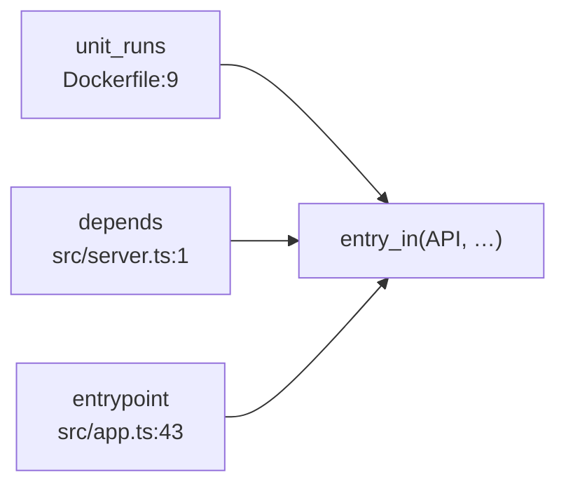

# 4. Le moteur de règles

Code : [vision/facts/datalog.ts](../../vision/facts/datalog.ts), règles communes dans [vision/packs/core.yaml](../../vision/packs/core.yaml). Décision : doc 07 §4.4, RYP-190.

## Le concept

Les faits d'un fichier ne disent rien des autres fichiers. Une architecture, elle, est faite de liens entre fichiers et entre programmes : une route appartient au service qui lance le fichier où elle est déclarée ; une file relie celui qui y écrit à celui qui la consomme. Ces liens sont **déduits** par des règles déclaratives, à la manière de Datalog, le langage de requêtes logiques qu'utilisent aussi CodeQL (GitHub) et Glean (Meta).

Une règle dit : « si ces faits sont établis, alors celui-ci l'est aussi ».

```
entry_in(R, F, K, Key) :- entrypoint(F, K, Key, _, _), reach(R, F).
```

Se lit : « le point d'entrée `Key`, déclaré dans `F`, appartient au déployable `R` si `R` atteint `F` ».

## La syntaxe

| Élément | Forme | Exemple |
|---|---|---|
| Règle | `tête :- corps, corps, … .` | `p(X) :- q(X, Y), r(Y).` |
| Fait écrit à la main | `tête.` | `table_tech("pgTable", postgresql, relational).` |
| Variable | commence par une majuscule ou `_` | `F`, `Key`, `_Ignoré` |
| Joker | `_` seul, ne lie rien | `entrypoint(F, _, Key, _, _)` |
| Constante | chaîne entre guillemets, nombre, ou mot en minuscules | `"add"`, `2`, `http` |
| Négation | `not relation(…)` | `not unit_command(C, S)` |
| Comparaison | `X = Y`, `X != Y` ; `X = "c"` lie `X` | `H != ""` |
| Ordre | `<`, `<=`, `>`, `>=` entre nombres | `G < L` : un intermédiaire placé avant la route |
| Concaténation | `P = cat(A, B, …)` colle des valeurs liées et lie `P` (comme `cat` dans Soufflé) | `Full = cat(Prefix, Path)` |
| Commentaire | `%` jusqu'à la fin de la ligne | `% une règle commune` |

Deux règles de sûreté sont vérifiées au chargement :
- toute variable de la tête, d'une négation ou d'une comparaison doit être liée par un fait positif du corps ;
- le joker `_` est interdit dans la tête.

## L'évaluation


- **Jusqu'au point fixe.** Les règles sont appliquées, encore et encore, jusqu'à ce qu'aucune n'ajoute de fait. Une règle récursive, comme la fermeture des imports, s'arrête donc d'elle-même, même s'il y a des cycles d'imports.
- **Par strates.** Une règle qui dit « sauf si » (`not r(…)`) n'est évaluée que quand `r` est entièrement calculée : on ne conclut pas à l'absence d'un fait qui pourrait encore apparaître. Si une négation se trouve dans un cycle de règles, le chargement échoue.
- **Les jointures** suivent l'ordre du corps : chaque fait est cherché par la première valeur déjà connue, grâce à un index par position construit à la demande.
- **Déterministe.** Les faits entrent dans l'ordre des fichiers, les règles s'appliquent dans l'ordre où elles sont écrites : mêmes entrées, mêmes résultats, dans le même ordre.

## Les preuves

Chaque fait déduit garde les preuves des faits qui l'ont produit, jusqu'à 60 lignes, sans doublon. C'est ce qui permet à l'interface d'afficher, sous un lien de la carte, les lignes qui le justifient : le lien n'existe que parce que ces lignes existent.



## Les règles communes

`core.yaml` ne contient aucun nom de pile : seulement des relations neutres jointes entre elles.

| Règle | Ce qu'elle déduit |
|---|---|
| `reach(R, H)` | un déployable atteint le fichier qu'il lance, puis tout ce que ce fichier importe, de proche en proche |
| `unit_runs(C, S, R)` | un service de composition construit depuis un dossier lance ce que lance le Dockerfile de ce dossier, sauf s'il donne sa propre commande |
| `resolves(F, N, G, L)` | le code derrière un nom : défini dans `F`, ou importé d'un fichier `G` du dépôt |
| `entry_in(R, F, K, Key)` | un point d'entrée appartient à chaque déployable qui atteint son fichier |
| `handler_at(F, Key, G, L)` | le code d'un point d'entrée, retrouvé par `resolves` |
| `implements_at`, `selects` | une classe qui implémente une interface du dépôt ; une fonction qui fabrique ses implémentations |
| `env_read(F, K, L)` | un nom de variable lu sur l'objet qui les déclare (`env.EMAIL_PROVIDER`) |

Les packs ajoutent leurs propres règles (chapitre 3) ; toutes sont évaluées ensemble.

## Les limites du moteur

- Une chaîne fabriquée par `cat` de plus de 1000 caractères est abandonnée : une règle récursive mal bornée s'arrête au lieu de tourner sans fin.
- Pas d'agrégat (compter, sommer) : quand il faut compter, par exemple « une interface implémentée au moins deux fois », l'assembleur le fait (chapitre 5).
- Pas de calcul incrémental des règles : un fichier modifié n'est relu que lui, mais les règles sont réévaluées en entier. Sur Nafar, elles prennent 375 ms. Un moteur existant ne sera pris que si la taille l'exige, mesure à l'appui (RYP-173).
