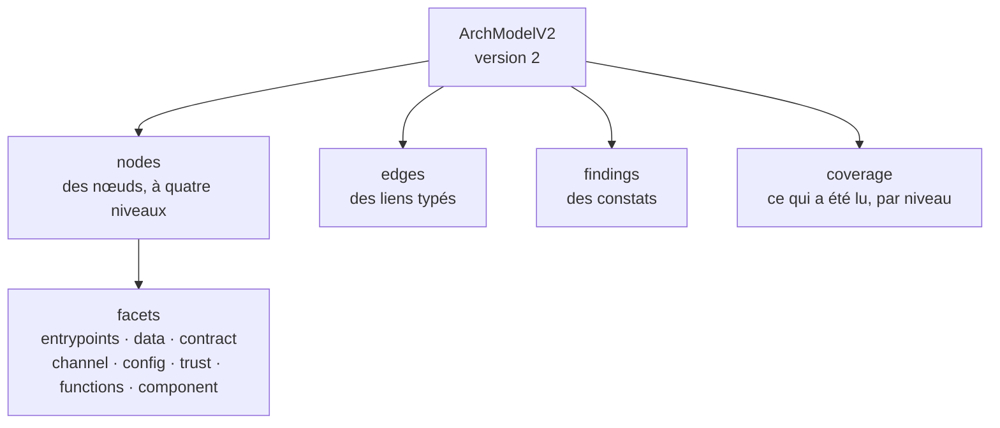
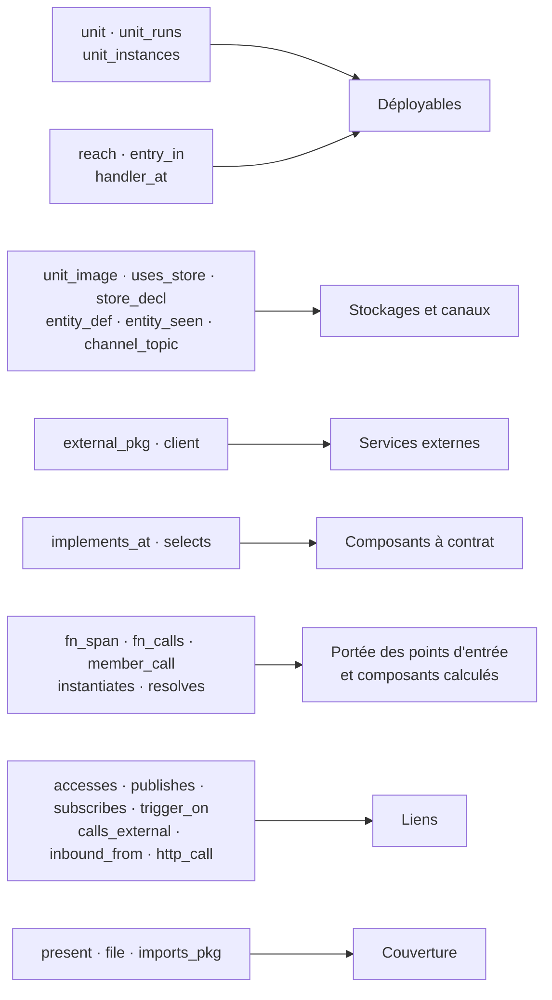

# 5. Le modèle neutre et l'assembleur

Code : [vision/arch/types.ts](../../vision/arch/types.ts) (`ArchModelV2`), [vision/arch/schema.ts](../../vision/arch/schema.ts), [vision/facts/assemble.ts](../../vision/facts/assemble.ts). Décision : [ADR 0017](../decisions/0017-modele-neutre.md).

## Le concept

Le modèle neutre est la carte que lisent l'interface et le serveur MCP. Sa **forme** ne contient aucun nom de technologie : une technologie peut être une valeur (`"tech": ["postgresql"]`, pour un logo), jamais un champ. Un écran s'affiche parce qu'un nœud porte une facette, pas parce que le projet utilise Firebase ou Postgres. La neutralité porte sur la forme, entre projets ; elle n'efface pas les technologies : chaque fait garde la technologie qui l'a produit, et ce que son pack sait de sa sémantique (ce qu'une transaction garantit, comment un événement est livré, à qui s'applique une règle d'accès) le qualifie. Les écrans montrent cette qualification au lieu d'aligner deux technologies sur une même case ([guide de lecture, principe 1](../lire-le-systeme/principes/01-le-systeme.md)). Aujourd'hui seules la forme du stockage (`shape`), les règles d'accès (`rule`), les contraintes et les attributs littéraux la portent ; une qualification des mécanismes reste à ajouter au modèle.

Le schéma est strict : un champ inconnu est refusé. Le type TypeScript et le schéma sont vérifiés identiques à la compilation.

## La forme

| Élément | Ce qu'il porte |
|---|---|
| **Niveau** | `system` (acteurs, services externes), `deployable` (ce qui s'exécute ou se stocke séparément), `component` (une partie d'un déployable), `code` (cité, jamais recopié : il vit dans `model.json`) |
| **Rôle** | `actor`, `external` ; `app`, `service`, `function`, `worker`, `job`, `store`, `channel`, `binary`, `managed` ; `module`, `layer`, `adapter` |
| **Statut** | `extracted` (lu), `proposed` (calculé par une règle), `declared` (écrit par un agent ou un humain) |
| **Facettes** | `entrypoints` (genre, clé, code, garde d'accès, appelants) ; `data` (forme, entités, champs, contraintes, déclencheurs, règle d'accès) ; `contract` (interface, opérations, implémentations, ce qui choisit) ; `channel` (files, topics, réglages) ; `config` (noms de variables, où elles sont lues, obligatoires ou non quand le code le dit : `env_required`) ; `trust` (comment un appelant prouve qui il est) ; `functions` (les fonctions du dépôt, ouvertes seules : leur déroulé, qui les appelle, ce qu'elles appellent) ; `component` (ce qu'un composant sert dans son déployable : sa classe, les points d'entrée servis, ses fonctions, ce qu'il touche) |
| **Lien** | genre `call`, `read`, `write`, `message`, `request`, `trigger`, `use`, `deploy` ; une cible fine facultative (une entité, un topic, un point d'entrée) ; ses occurrences, chacune avec sa ligne |
| **Preuve** | `path`, `line`, `text`, et sa **source** : `syntax`, `symbols`, `manifest`, `pack`, `runtime` (prévu), `declared` |
| **Couverture** | par niveau : lus sur total, et les trous : `language_not_read`, `pack_missing`, `target_unknown`, `path_dynamic`, `manifest_unknown` |

## L'assembleur

L'assembleur transforme les relations déduites en modèle neutre. Comme le moteur, il ne connaît aucune pile : il lit des relations neutres, que les packs produisent.

### Les déployables

Un déployable est identifié par **le fichier qu'il lance**. Plusieurs manifestes peuvent décrire le même : le Dockerfile, le service de composition et le processus fly.toml qui lancent tous `src/server.ts` sont un seul nœud. Son nom vient du manifeste le plus parlant (service de composition, puis processus, puis page, puis image).

- Son **code** : les fichiers qu'il atteint (`reach`).
- Ses **points d'entrée** : ceux de `entry_in`, avec leur code (`handler_at`), plus son démarrage (`main`).
- Son **rôle** : `app` pour une page, `function` pour une codebase de fonctions déployées une à une, `service` s'il reçoit des appels HTTP ou RPC, `worker` s'il ne fait que consommer des messages ou des tâches planifiées.
- Ses **technologies** : celles des paquets que son code importe vraiment, dans les catégories qui disent l'architecture.
- Ses **variables** : les noms déclarés ou lus dans son code, avec chaque endroit où ils sont lus.
- Ses **exemplaires** : `unit_instances` (le nombre minimum de machines).
- Un fichier lancé que rien ne lit (un service Python) reste un nœud, marqué « langage non lu », et devient un trou de couverture.

### Les stockages, canaux et services externes

Un stockage est identifié par sa technologie. Il naît d'une image de conteneur (`image_store`), d'une connexion ouverte par le code avec un pilote (`uses_store`, prouvé par la ligne qui l'ouvre : importer le pilote ne suffit pas), d'un produit géré déclaré par un manifeste (`store_decl`, par exemple Firestore dans `firebase.json`), ou d'entités déclarées (`entity_def`). Une entité vue seulement à l'usage (`entity_seen` : une table nommée par une requête SQL, une collection MongoDB) s'ajoute au stockage si rien ne la déclare ; une table déclarée par Drizzle garde sa déclaration comme preuve. Un stockage qui ne porte que des topics devient un `channel`. Un service externe naît d'un client construit avec un paquet connu (`external_pkg`).

### Le détail d'une entité

Chaque entité porte ce que les packs en lisent ([vision/facts/entity-detail.ts](../../vision/facts/entity-detail.ts)) : ses champs (type, obligatoire ou non, valeurs permises), ses contraintes (clé primaire, unicité, clé étrangère avec l'entité visée, index, règle de vérification, chacune à sa ligne) et ses déclencheurs (le code de la base qui s'exécute quand elle change, et les entités qu'il écrit).

Chaque champ porte aussi sa valeur par défaut quand elle est littérale, et ses écritures (`writes`) : la valeur quand elle est écrite en clair, la ligne, la fonction de premier niveau qui la contient, son déployable et ses points d'entrée. Une écriture dans une fonction importée revient aux points d'entrée des fichiers qui l'importent, pas à celui du fichier où elle est écrite. Une entité porte enfin sa section (`group`), lue dans le commentaire de séparation au-dessus de sa déclaration.

Exemple : `bookings.status` vaut `pending` par défaut. `expireHolds` (tâche planifiée chaque minute) l'écrit à `cancelled` dans `src/jobs/expire.ts:20`. `markRefunded` l'écrit à `refunded` dans `src/payments/refund.ts:27` : ce fichier porte aussi la route `POST /payments/:id/refund`, mais c'est le webhook Stripe qui importe `markRefunded`, et l'écriture lui revient. `on_hold` est déclaré, jamais écrit.

Exemple : `bookings` d'atelier-api a un index unique partiel `bookings_one_active` sur `(user_id, slot_id)` où `status in ('pending', 'confirmed')` (`src/db/schema.ts:55`) : un client ne peut pas tenir deux réservations actives sur un même créneau. Et le déclencheur `audit_bookings` (`drizzle/0001_audit.sql:12`), sur chaque mise à jour, écrit `audit_log`.

### Les composants à contrat

Une interface du dépôt implémentée au moins deux fois devient un composant `module`, rattaché au déployable qui atteint la fonction qui choisit l'implémentation. Sa facette `contract` porte l'interface, ses opérations, ses implémentations, et les noms de variables lus par la fonction qui choisit.

La syntaxe seule en donne le détail ([vision/facts/syntax-contract.ts](../../vision/facts/syntax-contract.ts), [vision/facts/contract-detail.ts](../../vision/facts/contract-detail.ts)), sans rien savoir du fournisseur :

- **La règle du module** : le commentaire qui ouvre son fichier d'entrée (`index`).
- **Ce que promet chaque opération** : le type qu'elle reçoit et celui qu'elle rend, champ par champ, avec le commentaire de l'auteur au-dessus de chaque champ, et les champs facultatifs.
- **Chaque implémentation** : ce que l'opération appelle hors de la classe (le client gardé par la classe, un nom importé d'un paquet, `fetch`, `console`), y compris dans les méthodes de la classe qu'elle appelle et dans les fonctions qu'elle passe en argument ; ses retours, là où la réponse native redevient le résultat du contrat ; les paquets que son fichier importe.
- **Qui choisit** : pour chaque `new` de la fonction qui choisit, la valeur qui y mène (`case "smtp"`, `if (x === "console")`), ou aucune pour le cas qui reste.
- **L'étanchéité** : les paquets des implémentations, et chaque import de l'un d'eux hors du module.

Exemple, l'envoi d'emails d'atelier-api : `EmailSender.send` reçoit un `EmailMessage` de 7 champs (« Même clé = même email : un job rejoué n'envoie pas deux fois ») et rend un `SendResult`. `ResendSender` appelle `client.emails.send`, `SmtpSender` `transport.sendMail`, `ConsoleSender` `console.log`. `getSender` prend `SmtpSender` pour `smtp`, `ConsoleSender` pour `console`, `ResendSender` sinon. `resend` et `nodemailer` ne sont importés nulle part ailleurs.

Même lecture sur la couche IA d'un projet réel : `AiProvider.turn` et ses trois adaptateurs, l'appel de Gemini étant fait dans la fonction passée à `withNetworkRetry`, et un import de `@google/genai` hors du module signalé.

Limites : un type écrit ailleurs que dans une interface ou un type objet (une classe, un schéma Zod) ne donne pas ses champs ; une valeur de choix calculée n'est pas reprise.

### Les liens

| Relation | Lien |
|---|---|
| `accesses(F, read\|write, Tech, Entité, L)` | déployable qui atteint `F` → stockage, sur l'entité |
| `publishes(F, Topic)` | déployable → canal du topic |
| `subscribes(F, Topic)` | canal → déployable, sur son point d'entrée `message` |
| `trigger_on(F, Clé, Tech, Cible)` | stockage ou canal → déployable, sur le point d'entrée de cette clé : une écriture dans une collection, un fichier déposé, un message publié, une tâche mise en file |
| `calls_external`, `client` | déployable → service externe |
| `entry_guard(F, L, role\|auth, G, D)` | la garde du point d'entrée déclaré à `F:L` : `role` (une fonction du dépôt qui répond 403, ou qui en appelle une) l'emporte sur `auth` (401) ; la fonction `G:D` qui la tient devient `access.by`, la première que la route ou un intermédiaire posé avant elle appelle |
| `guards_read(F, L)` | un pack sait lire les gardes du point d'entrée déclaré à `F:L` : sans `entry_guard`, sa garde devient `public`. Une entrée qu'aucun pack ne sait garder n'a pas de garde, ce qui ne veut pas dire publique |
| `inbound_from(F, Paquet, L)` | service externe → le point d'entrée dont le code vérifie sa signature (dans `F`, le dernier dont le code commence avant la ligne `L`) ; la garde d'accès devient `signature` |
| `http_call(F, Méthode, Chemin, L)` | déployable → déployable qui a la route de même méthode et même chemin (`/bookings/${id}` et `/bookings/:id` sont le même chemin) ; une route dont la méthode n'est pas écrite (`ANY`) répond à toutes |

### Ce que fait chaque point d'entrée

Une fois les liens posés, chaque point d'entrée reçoit sa **portée** : ce que son code exécute vraiment, lu au niveau des fonctions ([vision/facts/fn-graph.ts](../../vision/facts/fn-graph.ts), [vision/facts/entry-reach.ts](../../vision/facts/entry-reach.ts)). On part de sa fonction, puis on suit, de proche en proche et sans sortir de son déployable, trois formes d'appel, chacune résolue jusqu'à sa déclaration dans le dépôt (`resolves`) :

- un appel par le nom (`fn_calls`, `price(items)`) : la fonction appelée ;
- un appel sur une valeur importée (`member_call`, `db.select()`, `wallet.debit()`) : la fonction si c'en est une, sinon le fichier de la valeur (un client, un objet), sans fonction précise ;
- une construction (`instantiates`, `new SmtpSender()`) : le fichier de la classe.

`files` est la liste des fichiers de ces fonctions et de ces valeurs ; `ranges`, les lignes de son propre fichier qu'il exécute (sa fonction et les fonctions du fichier qu'elle appelle). Un fichier que la déclaration importe sans qu'aucune de ses fonctions soit appelée **n'en fait pas partie** : un index qui importe tous les gestionnaires ne donne plus tout à chacun. Quand plusieurs points d'entrée sont écrits dans une même fonction, chacun n'exécute que sa branche (les appels entre sa ligne et celle du suivant). Un point d'entrée dont la fonction n'est pas connue garde l'ancienne lecture : son fichier et ce qu'il importe (`depends`).

Chaque occurrence d'un lien sortant reçoit alors les points d'entrée qui l'atteignent (`entrypoints`) :

- dans un fichier qui porte des fonctions de points d'entrée, à partir de la première, elle revient à la dernière qui commence avant elle : les routes d'un même fichier ne se partagent pas leurs effets ;
- écrite dans une fonction, elle revient aux points d'entrée dont la portée contient cette fonction ; si aucun ne l'atteint par les appels lus, à ceux qui exécutent un fichier qui importe la fonction par son nom (elle y est passée en valeur : un middleware, un rappel) ; sinon à personne ;
- écrite hors de toute fonction (le code du module), elle revient à chaque point d'entrée qui atteint son fichier par imports.

Exemple : `POST /payments` d'atelier-api a pour fonction `createPayment` (`src/payments/create.ts`). Sa portée : `create.ts`, `keys.ts` (la clé d'idempotence), `session.ts` (il appelle `requireUser`), `http.ts` (`new HttpError`), `db.ts` et `stripe.ts` (il emploie leurs clients). Il lit `bookings`, `payments`, `sessions` et `users`, écrit `payments`, appelle Stripe. La lecture par fichier lui donnait aussi l'écriture de `sessions`, faite par `openSession`, que la route n'appelle jamais. Sur learn-app, `exoFeedbackQuota`, déclarée dans l'index, passe de 47 fichiers à 3.

Limites : une fonction passée en valeur n'est suivie que si un fichier exécuté l'importe par son nom ; un appel écrit dans une méthode de classe ou à travers une variable locale (`const s = getSender(); s.send()`) n'est pas suivi au-delà de ce qui le construit ; une valeur lue sans appel (une constante, un type, `config.X`) ne fait pas entrer son fichier dans la portée.

### Les composants calculés

Entre le déployable et la fonction, un **composant** est un groupe de fichiers qui travaillent ensemble pour les mêmes points d'entrée. Il est calculé depuis ce qui s'exécute, jamais depuis les dossiers ([vision/facts/components.ts](../../vision/facts/components.ts)). Le nœud est au niveau `component`, de rôle `module`, rattaché à son déployable (`parent`), avec `status: "proposed"` : c'est un calcul, pas un fait lu.

1. **Qui sert qui.** Un fichier du déployable sert les points d'entrée dont la portée l'exécute. Un fichier qu'aucun n'exécute (un type, un script, du code mort) n'entre dans aucun composant.
2. **Le regroupement.** Deux fichiers dont l'un appelle l'autre et qui servent exactement les mêmes points d'entrée sont dans le même composant, de proche en proche. Un fichier appelé aussi d'ailleurs sert plus de points d'entrée : il reste à part, c'est un composant partagé.
3. **Les contrats.** Un composant à contrat (lu dans le code, `status: "extracted"`) garde son nœud : un groupe calculé dont tous les fichiers sont les siens s'y fond, et le nœud reçoit la facette `component` avec `grouping: "contract"`. Les autres groupes ont `grouping: "calls"`.
4. **La classe** (`reach`), relative au déployable, E étant le nombre de ses points d'entrée dont la portée est connue :
   - `base` : il sert au moins les trois quarts de E, à condition que E vaille au moins 4 (en dessous, tout composant partagé serait le socle) ;
   - `own` : tous les points d'entrée qu'il sert ont leur fonction dans un même composant, le sien ou un autre (une route et son aide, un sous-système qu'une seule fonction lance). Un point d'entrée dont la fonction est dans un composant `base` (un index qui les déclare toutes) ne forme un groupe qu'avec lui-même ;
   - `shared` : sinon.

   Le groupe de fonctionnalités d'un point d'entrée n'existe pas tant qu'aucune connaissance ne le déclare : on prend le composant qui porte sa fonction. Un déployable à un seul point d'entrée n'a pas de composants calculés.
5. **Ce qu'il porte** (facette `component`) : les points d'entrée servis (`entrypoints`), le nombre de fonctions de ses fichiers (`functions`), et ce qu'il touche (`touches`) : les occurrences des liens du déployable écrites dans ses fichiers, par genre et par cible (entité, topic ou nœud), avec leurs lignes. Ces accès restent sur le composant : les liens de la carte partent toujours du déployable.
6. **Ses appels.** Un lien `call` va d'un composant à un autre du même déployable, avec le nombre de lignes d'appel et ces lignes. Les occurrences ne portent pas de points d'entrée : ce ne sont pas des effets.

**Le nom** vient des fichiers, jamais d'un sens inventé : le nom du fichier seul ; le dossier quand le groupe tient dans un dossier et en contient tous les fichiers exécutés, sous-dossiers compris (`video/`) ; sinon le fichier de tête suivi du nombre des autres (`tutor.ts +2`). La tête est le fichier qui porte le plus de fonctions de points d'entrée, puis le plus appelé depuis l'extérieur du groupe. Deux têtes du même nom gardent autant de dossiers parents qu'il faut (`bookings/get.ts`, `workshops/get.ts`). L'`id` est un chemin, stable d'une carte à l'autre : `api:src/auth/session.ts`. Un nom métier ne peut venir que d'une connaissance déclarée.

Exemple, la codebase `functions` de learn-app (16 points d'entrée) : `db.ts` est le socle (16 sur 16, ne touche aucune donnée lui-même) ; `telemetry.ts` (8) et `wallet.ts` (6, le seul composant à écrire `users/{}/wallet` et `users/{}/creditTx`) sont partagés ; les fichiers de la couche IA, servis par les mêmes 7 points d'entrée et qui s'appellent, se fondent dans le composant à contrat `functions/src/ai` ; `awa.ts +4` (la recherche), `tutor.ts +2` et `video/` (8 fichiers, 58 fonctions) sont propres à leur point d'entrée ; `access-mirror.ts` est propre aux trois fonctions d'`access.ts`. Sur `api` d'atelier-api (18 points d'entrée), chaque route a son fichier : `db.ts` est le socle, `session.ts` (10) et `http.ts` (11) sont partagés, `webhooks/stripe.ts +1` réunit le webhook et la confirmation qu'il est seul à appeler.

Limites : celles de la portée ; deux fichiers qui servent presque les mêmes points d'entrée restent séparés ; un fichier sans fonction exécutée (un schéma, des types) n'apparaît dans aucun composant.

### Le déroulé d'un point d'entrée

Chaque point d'entrée dont la fonction est connue reçoit son déroulé (`flow`) : ce que son code fait, dans l'ordre des lignes. Les liens de la carte donnent les lectures, écritures, appels et mises en file, avec leur cible ; la syntaxe donne les refus (`throw`), les retours anticipés, les réponses et le commentaire de l'auteur au-dessus de chaque instruction. Une fonction du dépôt appelée est dépliée là où elle est appelée, un cran plus profond, jusqu'à trois crans, si elle fait quelque chose de visible. Rien n'est résumé : chaque étape est une ligne du code.

Exemple, `POST /payments` : `requireUser` (dépliée : refus 401, lecture de `sessions`) ; lecture de `bookings` ; refus 404, 409, 410 (« une place gardée trop longtemps bloque les autres clients ») ; lecture de `payments` ; Stripe `paymentIntents.retrieve` puis réponse si un paiement est déjà en cours ; Stripe `paymentIntents.create` (« Un double clic ne doit jamais débiter deux fois ») ; refus 502 si Stripe échoue ; écriture de `payments` ; réponse.

Quand plusieurs points d'entrée sont écrits à l'intérieur d'une même fonction (`createServer((req, res) => { if (req.url === "/a") … })`), aucun ne reçoit de déroulé : celui de la fonction mêle toutes leurs branches.

Limites : une condition écrite sur plusieurs lignes ou trop longue n'est pas reprise ; un appel par une méthode d'objet (`service.pay()`) n'est pas déplié ; un refus levé par une fonction d'une bibliothèque n'apparaît pas.

### Une fonction ouverte seule

Chaque fonction de premier niveau d'un fichier lu reçoit la même lecture qu'un point d'entrée, comme si on la lançait seule (`functions`, écran Code) : son déroulé, les lignes du dépôt qui l'appellent avec la fonction qui les contient, et ce qu'elle appelle par son nom, en disant si la fonction appelée est dans le dépôt. Un nom appelé plusieurs fois compte une fois, à sa première ligne. Elle est gardée si elle fait quelque chose de visible ou si une ligne du dépôt l'appelle ; une fonction muette que personne n'appelle n'apprend rien. Les fichiers de test ne sont ni lus comme du code du produit ni comptés comme appelants. Une fonction est rattachée au premier déployable dont elle fait partie. Une fonction passée en dernier à un appel qui l'emballe est lue sous le nom de la constante (`export const pay = onCall(opts, async (req) => …)`, `const h = asyncHandler(async (req, res) => …)`) : ses appels comptent, et le point d'entrée qu'elle porte reçoit son déroulé.

Exemple, `requireUser` dans atelier-api : refus 401, lecture de `sessions` ; appelée par huit lignes, une par route gardée ; elle appelle `eq`, `and`, `gt`, des fonctions de la bibliothèque de requêtes, pas du dépôt.

Limites : celles du déroulé ; une méthode de classe n'est pas une fonction de premier niveau et n'est pas ouverte seule, et un appel écrit dans une méthode ou dans un rappel posé sur place (`app.get("/x", async () => …)`) n'est pas compté ; deux mille fonctions au plus par carte.

### Ce qui tourne sans clic

L'écran Messages ne lit rien de plus que la carte : il choisit les points d'entrée qu'aucune personne ne déclenche. Ce sont les tâches planifiées, les files écoutées, les événements, et les routes qu'un service externe appelle en signant (la garde du point d'entrée est `signature`).

- **Quand** : une expression cron est placée sur la journée (minutes, heures, plages, pas, listes). Au-delà de 48 lancements par jour, elle est dite en continu. Une expression qu'on ne sait pas lire est rendue telle qu'écrite, jamais placée.
- **Combien de fois** : le constat `scheduled_on_every_instance` et le nombre d'exemplaires du bloc (`instances`, lu au déploiement). Chez atelier-api, `fly.toml` déclare 2 machines : chaque tâche part 2 fois.
- **Les branches** : les fonctions du dépôt appelées sous une condition, dans le déroulé, la condition reprise telle qu'écrite. Le webhook Stripe en a trois, une par `event.type`.
- **Qui met en file** : chaque ligne qui publie sur la file, avec le point d'entrée qui l'exécute.
- **Les variables** : les noms lus dans les fichiers que le point d'entrée exécute, jamais les valeurs. Un fichier qui lit plus de la moitié des variables du bloc les déclare : il ne dit pas qui s'en sert, il est écarté.

Ce qui n'est pas lu : si une tâche a réellement tourné (aucune trace d'exécution), et ce que fait l'émetteur d'un événement quand il ne reçoit pas de réponse.

### La couverture

- **Déployables** : les manifestes lus ; un fichier lancé non lu est un trou `language_not_read`.
- **Composants** : les fichiers de code lus sur ceux présents ; chaque extension de code non lue est un trou ; chaque technologie importée qu'aucun pack ne déclare savoir lire est un trou `pack_missing` ; ce qu'un pack a reconnu sans pouvoir le relier (une adresse calculée, une cible inconnue) est un trou `path_dynamic` ou `target_unknown`.
- Chaque trou garde son premier endroit (`proof`) et tous ses endroits (`where`) : un fichier `.py` non lu, chaque import d'une technologie sans pack, chaque appel dont l'adresse est calculée. C'est ce qui permet de dire d'un élément absent de la carte s'il est non lu ou manqué.

## Les constats

La facette des constats (`uncalled_entry`, `unguarded_route`, `race_read_then_write`, `write_then_enqueue`, `order_assumption`, `personal_data_logged`…) est remplie par l'assembleur pour ce qui ne dépend que de la carte (une route sans appel, des tâches planifiées sur plusieurs instances), et par les règles des packs pour le reste. Chaque détecteur, ce qui le déclenche et ce qui le fait taire : [Les constats](constats.md).
