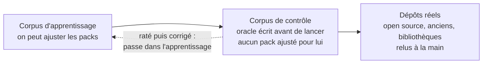

# 6. Ce qu'on sait faire, et comment on le vérifie

## Ce qui est affirmé au 01/10/2026

- **atelier-api** ([tests/corpus/atelier-api](../../tests/corpus/atelier-api)) est entièrement lu par les règles : 9 nœuds sur 9, 21 points d'entrée sur 21 avec la ligne de leur code, 14 tables, 30 liens sur 30 de l'oracle. 14 des 16 constats attendus sont produits (5 routes sans appel, les tâches planifiées sur deux machines, les deux connexions sans délai, le corps de l'inscription écrit dans le journal, la fonction d'import jamais appelée, la valeur `on_hold` que rien n'écrit, l'export d'administration gardé par une simple connexion, la réservation écrite puis mise en file hors transaction, l'expiration qui annule sans revérifier l'état). En plus, vrais et relus à la main, que l'oracle n'avait pas : 2 fonctions de l'app web jamais importées, 3 valeurs permises jamais écrites (`users.role` : `admin`, `instructor` ; `refunds.status` : `failed`), la demande de nouveau mot de passe qui écrit puis publie sans transaction commune. Les 2 constats restants (une hypothèse d'ordre contraire à un commentaire, le README contredit par le code) demandent de comprendre un texte : ils reviennent à un agent ([Les constats](constats.md)). Ces détecteurs ont été construits avec atelier-api sous les yeux : ce score dit qu'ils trouvent ce qu'ils visent ici, pas encore ce qu'ils valent sur un projet inconnu.
- **Une app Firebase** est encore lue par la carte version 1, que l'interface actuelle affiche ; les deux partiront ensemble ([Vue d'ensemble](01-vue-d-ensemble.md#la-carte-darchitecture-et-le-code-qui-part)). Sous le nouveau moteur, sa couverture dit ce qui manque : le pack Firebase, en pause (189 fichiers), et 28 fichiers Python.
- **Sur trois projets jamais vus** (le corpus de contrôle, 02/10/2026), le résultat est mauvais, et il est publié tel quel. Le tableau est juste après.
- **Rien d'autre n'est affirmé.**

## Le premier contrôle à l'aveugle (02/10/2026)

Trois projets pris sur GitHub. Pour chacun, l'oracle a été écrit en lisant le code et commité avant le premier lancement. Aucun pack n'a été modifié depuis. Le détail de chaque projet, et la raison de chaque manque, sont dans son `resultat.md`.

| Projet | Ce qu'il teste | Trouvé | En plus (relu) | Faux | Non lu | Manqué sans le dire |
|---|---|---|---|---|---|---|
| [example-voting-app](../../tests/corpus/controle/example-voting-app/resultat.md) | microservices en Python, Node et C#, Redis, Postgres | 8 / 39 | 1 (vrai) | 0 | 15 | 16 |
| [node-express-boilerplate](../../tests/corpus/controle/node-express-boilerplate/resultat.md) | Express monté sous `/v1` par une boucle, contrôleurs, Mongoose | 2 / 55 | 0 | 0 | 0 | 53 |
| [OpenArchiver](../../tests/corpus/controle/openarchiver/resultat.md) | Express, Drizzle et BullMQ écrits par d'autres, cinq processus dans un conteneur | 24 / 406 | 10 (9 vrais) | 1 | 29 | 353 |

Ce que ça dit :

- **Ce qui est montré est presque toujours vrai** : 1 faux sur 11 éléments en plus relus (un « serveur SMTP » déduit de nodemailer, alors que le code ne fait que construire un fichier EML).
- **Ce qui manque n'est presque jamais dit.** C'est la règle du chapitre qui ne tient pas. Sur node-express-boilerplate, la couverture annonce tout lu (51 fichiers sur 51), alors que la carte n'a ni service ni route.
- **La première cause est le lancement.** Quand le processus est lancé par un script de `package.json`, par `concurrently`, par pm2 ou par un `command` de Compose, aucun déployable n'est créé. Alors ses routes, ses variables et ses liens disparaissent aussi. OpenArchiver a ses 23 tables lues, mais aucun de ses 78 points d'entrée.
- **Un service Compose dont le langage n'est pas lu disparaît**, au lieu d'apparaître marqué non lu (`vote` en Python, `worker` en C#).
- **Une technologie sans pack n'est pas toujours déclarée** : Mongoose, Meilisearch et socket.io ne figurent pas dans la couverture.

Ces trois projets ont maintenant servi : une forme corrigée grâce à eux les fait passer dans l'apprentissage, et il faudra trois nouveaux projets de contrôle pour juger les corrections.

## Ce que vise VisionLayer

atelier-api est un projet de référence : il sert à construire et à tester. La cible, c'est un projet que nous n'avons jamais vu, et dont VisionLayer doit étaler le système avec le même niveau de détail.

C'est possible parce qu'un pack ne décrit pas un projet : il décrit **une technologie**. Les projets diffèrent par leurs données, leurs responsabilités, leurs décisions métier ; les outils qu'ils emploient sont les mêmes. Deux projets Express déclarent leurs routes avec la même API d'Express. Une fois cette API écrite dans le pack, n'importe quel projet Express est lu, quel que soit son domaine.

## Ce qu'un projet de référence ne montre pas

Un projet n'emploie qu'une partie de l'API d'une technologie. atelier-api déclare ses routes par `app.post(…)` et `router.get(…)` ; un autre projet peut passer par `app.route("/x").get(…)` ou monter un routeur sous un préfixe. Ce sont des formes de la même technologie, et un pack doit les connaître toutes.

C'est pour ça qu'un score sur atelier-api ne suffit pas encore à le dire : il montre que le moteur marche de bout en bout et que les formes employées par ce projet sont lues, pas que toutes les formes de la technologie le sont. Les projets que nous n'avons pas écrits révèlent celles qui manquent. Une forme ajoutée au pack sert ensuite à tous les projets qui emploient cette technologie.

D'où la façon d'écrire un pack : partir de l'API de la technologie, telle que sa documentation la décrit, et non du code d'un projet ; et donner à chaque forme un petit exemple de test. Le chapitre 3 liste les formes connues qui ne sont pas encore couvertes.

## La règle qui doit tenir

Ce que VisionLayer ne reconnaît pas doit apparaître comme **non lu**, jamais disparaître. C'est vrai aujourd'hui pour un langage non lu et pour une technologie sans pack. Ce n'est pas encore vrai pour une construction inconnue dans un fichier lu, par exemple une route écrite d'une façon qu'aucun pack ne connaît : la carte peut encore se taire sans le dire. Le contrôle à l'aveugle du 02/10 le mesure : 422 éléments manqués sans le dire sur 500 attendus. C'est le premier chantier.

### Ce qui tourne sans être lu est sur la carte (01/11/2026)

Code : [vision/facts/unread.ts](../../vision/facts/unread.ts). Trois sortes d'éléments disparaissaient de la carte. Ils y sont maintenant, marqués « non lu », avec leur technologie et la ligne qui les prouve, sans point d'entrée ni lien inventé :

| Élément | Comment il est reconnu | Exemple |
|---|---|---|
| une app faite avec un framework sans pack | un paquet dont le code importe un framework du catalogue qu'aucun pack ne lit, et dont aucun programme lu n'exécute le code ; nommée par le service qui construit son dossier, sinon par son paquet | une boutique Next.js lancée par `node server.js`, un fichier produit par la compilation : l'app `web`, « Next.js : non lu » |
| un serveur lancé par son image | une image qu'un manifeste fait tourner sans la construire, qu'aucun pack ne reconnaît, et qui n'est pas celle que le dépôt publie lui-même | `getmeili/meilisearch` : un stockage `search`, « image meilisearch : non lue » |
| un service appelé par sa bibliothèque | un paquet du catalogue de famille cloud ou IA, ou un serveur de données qui a sa propre image, importé par le code d'un programme ; relié à ce programme par un lien `use`, un par import | `@aws-sdk/client-s3` importé par le serveur : AWS, extérieur, non lu |

La couverture des fichiers donne deux nombres :
- **Analysés** : le lecteur de syntaxe les a ouverts.
- **Compris** : un programme dont le lancement est lu les exécute.

Un test, une configuration ou le code d'une app sans pack sont analysés sans être compris. Sur la boutique Next.js : 223 fichiers analysés, 0 compris. Les composants `.svelte`, `.vue` et `.astro` comptent comme un langage non lu.

Un programme lancé par une image prend le nom que lui donne son paquet :
- le script qui le lance, sans `start:` ni `:dev` : `start:ingestion-worker` donne `ingestion-worker` ;
- ou le nom du paquet, pour son script principal : `@open-archiver/backend` donne `backend`.

Avant, il prenait le nom du dossier du Dockerfile (`docker`).

## Comment on vérifie

1. **Le corpus d'apprentissage** sert à construire : atelier-api, puis une app Next.js avec Prisma et un service Python. On y ajuste les packs autant qu'il faut. Le rangement et la règle sont dans [tests/corpus/README.md](../../tests/corpus/README.md).
2. **Le corpus de contrôle** sert à juger. Ce sont des projets que les packs n'ont jamais vus. L'oracle est écrit avant de lancer VisionLayer, et aucun pack n'est modifié pour le faire passer. Quand un projet de contrôle échoue et qu'on corrige un pack, il passe dans l'apprentissage ; il faut alors un nouveau projet de contrôle.
3. **Les dépôts réels** : des projets open source de toutes tailles, des projets anciens, des bibliothèques, choisis pour être différents de ce qu'on connaît, relus à la main. Le résultat est publié, bon ou mauvais.

Trois mesures pour chaque projet :

| Mesure | Question |
|---|---|
| **Trouvé** | ce que l'oracle attend, VisionLayer le montre-t-il ? |
| **Faux** | ce que VisionLayer montre existe-t-il vraiment ? |
| **Non lu** | ce qui n'est pas montré est-il dit comme tel ? |

`vision facts <projet> --score` ([vision/facts/score.ts](../../vision/facts/score.ts)) les calcule, ligne par ligne (nœuds, points d'entrée, entités, liens, constats…). Il apparie les nœuds par ce qu'ils contiennent (points d'entrée, technologie, contrat), jamais par leur nom. Pour chaque ligne, il donne :

- **trouvé** : dans l'oracle et dans la carte ;
- **en plus** : dans la carte, pas dans l'oracle. L'outil ne peut pas trancher seul : c'est un faux, ou un oubli de l'oracle. Chaque élément est relu à la main dans le code ; seuls ceux qui n'existent pas comptent comme faux ;
- **non lu** : absent de la carte, et la couverture le dit. Un fichier qui prouve l'élément dans l'oracle est désigné par un trou de couverture (langage non lu, technologie sans pack, adresse calculée) ;
- **manqué** : absent de la carte sans que rien ne le dise. C'est le pire cas : la carte a l'air complète.

Exemple sur atelier-api, au 02/10/2026 : 122 éléments trouvés sur 124, 0 non lu, 2 manqués (les deux constats qui reviennent à un agent), et 14 en plus. Les 14 ont été relus : tous existent dans le code, ce sont des oublis de l'oracle. Par exemple, `workshops/list.ts` lit `instructors` par une jointure ; `session.ts` lit `NODE_ENV`. Il y a 0 faux.

## Les styles d'architecture

| Style | Projet de test | État |
|---|---|---|
| Client-serveur | atelier-api | lu par les règles |
| Files de messages | atelier-api | BullMQ seulement |
| Événementiel (Pub/Sub, Kafka) | un projet réel en partie | pas encore |
| Serverless | un projet réel | pack Firebase en cours |
| Microservices | aucun | jamais testé |
| Monolithe ancien | aucun | jamais testé |
| Bibliothèque | aucun | jamais testé |
