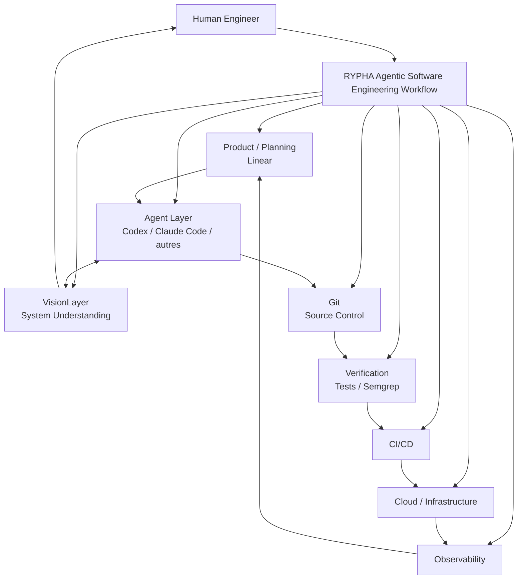
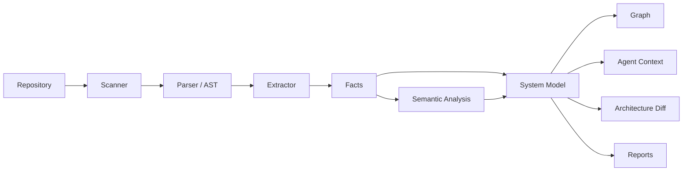
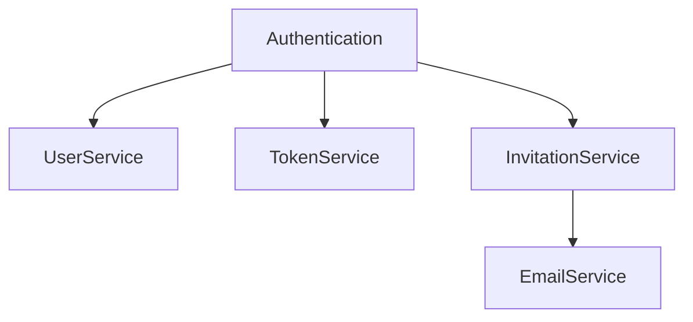
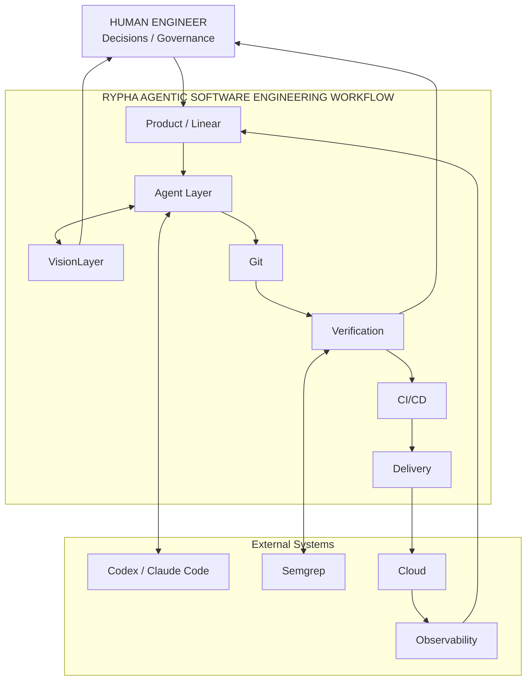

# RYPHA Agentic Software Engineering Workflow
## Architecture d'implémentation du Workspace d'ingénierie agentique

**Organisation :** RYPHA  
**Projet pilote :** Nafar  
**Composant de compréhension système :** VisionLayer  
**Principe :** *Agent-executed, human-governed.*

---

## 1. Objectif

RYPHA développe des SaaS et des solutions clients dans un contexte où les agents IA permettent désormais de produire énormément de logiciel très rapidement.

Le problème n'est donc plus seulement de savoir comment coder plus vite. Il faut surtout éviter que la vitesse de génération du code dépasse la capacité humaine à comprendre et gouverner le système.

Le workflow RYPHA doit permettre :

- de partir d'un besoin produit ;
- de le transformer en spécification et tâches ;
- de donner le contexte pertinent aux agents ;
- de laisser les agents implémenter et vérifier ;
- de maintenir une représentation actualisée du système ;
- de comprendre les changements au niveau logique et architectural ;
- de descendre directement jusqu'au code ;
- de vérifier les changements ;
- de conserver des points de décision humaine ;
- de déployer et surveiller le logiciel ;
- de transformer les problèmes de production en nouvelles tâches d'ingénierie.

L'objectif est :

> **Construire plus vite sans perdre la maîtrise de ce que RYPHA construit.**

---

# 2. Le Workspace RYPHA

Le workflow n'est pas une plateforme destinée à remplacer tous les outils existants.

Il constitue une architecture qui relie les outils.



## Responsabilité de chaque couche

| Couche | Responsabilité |
|---|---|
| Product | Besoin, fonctionnalités, exigences |
| Linear | Projets, issues, priorités, cycles |
| Agent Layer | Raisonnement et exécution |
| VisionLayer | Compréhension et représentation du système |
| Git | Source de vérité du code et historique |
| Tests | Vérification comportementale |
| Semgrep | Règles statiques, sécurité, conventions |
| CI/CD | Validation et livraison |
| Cloud/IaC | Infrastructure et runtime |
| Observability | État réel du système en production |
| Human Governance | Décisions, arbitrages, approbations |

Le workflow doit rester **agent-agnostic** et **tool-agnostic**.

---

# 3. VisionLayer

## 3.1 Définition

VisionLayer est une capacité du workflow qui répond à :

> **Comment le logiciel fonctionne-t-il, comment ses parties sont-elles reliées et où cette logique est-elle implémentée ?**

VisionLayer maintient une représentation exploitable du codebase.

Il décrit notamment :

- systèmes ;
- services ;
- modules ;
- composants ;
- responsabilités ;
- dépendances ;
- interfaces ;
- flux ;
- contrats ;
- symboles ;
- références vers le code ;
- changements architecturaux.

## 3.2 Ce que VisionLayer n'est pas

VisionLayer n'est pas :

- un IDE ;
- Git ;
- Linear ;
- un static analyzer ;
- un LLM ;
- un agent ;
- une CI ;
- une documentation statique générée une fois.

Mermaid n'est pas non plus la source de vérité. Mermaid est une projection possible du modèle.

---

# 4. Modèle d'observation

VisionLayer doit permettre de descendre progressivement dans le système.

```text
SYSTEM
  ↓
SERVICE
  ↓
MODULE
  ↓
COMPONENT
  ↓
LOGICAL FLOW
  ↓
SYMBOL
  ↓
SOURCE LOCATION
```

Exemple :

```text
Nafar
  ↓
Learning Engine
  ↓
Tutor
  ↓
Hint Policy
  ↓
Adaptive Hint Flow
  ↓
HintPolicy.evaluate()
  ↓
src/tutor/policy.ts:184
```

L'ingénieur peut commencer avec une vue globale et atteindre directement le code.

---

# 5. Modèle interne de VisionLayer

Le modèle doit être indépendant de l'interface.

Conceptuellement :

```text
Repository
 ├── Revision
 ├── File
 ├── Symbol
 ├── Component
 ├── Dependency
 ├── Interface
 ├── Flow
 ├── Contract
 └── Reference
```

Relations :

```text
Repository
    ↓ contains
File
    ↓ contains
Symbol
    ↓ belongs_to
Component
    ↓ depends_on
Component
    ↓ participates_in
Flow
    ↓ constrained_by
Contract
```

Une représentation JSON initiale peut ressembler à :

```json
{
  "id": "component.invitation-service",
  "type": "component",
  "name": "InvitationService",
  "source": {
    "path": "src/modules/invitations/service.ts",
    "revision": "git-sha"
  },
  "depends_on": [
    "InvitationRepository",
    "TokenService",
    "EmailService"
  ]
}
```

Le format exact devra être défini pendant le prototype.

---

# 6. Faits et interprétations

VisionLayer doit distinguer les faits déterministes des interprétations IA.

### Fait

```text
InvitationService appelle TokenService.
```

### Interprétation

```text
TokenService est responsable de la génération
et de la validation des tokens d'invitation.
```

Les faits doivent être produits autant que possible par l'analyse du code.

L'IA peut enrichir le modèle sémantique, mais ne doit pas être la seule source de vérité.

Architecture :

```text
Repository
   ↓
Parser / AST / analyse statique
   ↓
Deterministic Facts
   +
LLM Semantic Interpretation
   ↓
Vision Model
```

---

# 7. Pipeline VisionLayer



Le scanner découvre le repository.

Les parsers extraient les éléments du code.

L'extractor construit les relations.

Le modèle sémantique centralise ces informations.

Les différentes interfaces utilisent ensuite ce modèle.

---

# 8. Mermaid

Le premier prototype peut générer :

```text
.vision/
├── model.json
├── graph.mmd
└── metadata.json
```

Exemple :



L'interface pourra plus tard enrichir cette représentation avec :

- navigation ;
- clic sur les composants ;
- dépendances ;
- flows ;
- références ;
- liens vers l'éditeur ;
- architecture diff.

Le modèle interne doit rester indépendant de Mermaid.

---

# 9. Agent Context

C'est probablement l'une des capacités les plus importantes de VisionLayer.

Un agent ne devrait pas recevoir aveuglément tout le repository.

Pour :

```text
Implement invitation expiration.
```

l'agent peut demander :

```bash
vision context --task "implement invitation expiration"
```

VisionLayer retourne :

```text
RELEVANT SYSTEM

Authentication
 └── Invitations
      ├── InvitationService
      ├── InvitationRepository
      ├── TokenService
      └── EmailService

RELEVANT FLOW

Create invitation
      ↓
Generate token
      ↓
Persist expiration
      ↓
Send email

CONSTRAINTS

- token is single-use
- invitation expires

RELEVANT FILES

src/auth/invitation/service.ts
src/auth/token/service.ts
src/auth/invitation/repository.ts
```

L'agent dispose donc d'un **contexte structurel avant de modifier le code**.

---

# 10. Mise à jour après modification

Le principe central est :

> **Un changement significatif du code doit pouvoir produire un changement correspondant dans la représentation du système.**

Flux :

```text
Agent
  ↓
Code change
  ↓
Tests
  ↓
Semgrep
  ↓
Vision update
  ↓
Architecture diff
  ↓
Change report
  ↓
Human review
```

Commande initiale :

```bash
vision update
```

---

# 11. Architecture Diff

Git montre le diff du code.

VisionLayer doit montrer le **diff du système**.

Avant :

```text
Authentication
├── UserService
└── TokenService
```

Après :

```text
Authentication
├── UserService
├── TokenService
└── InvitationService
      └── EmailService
```

Rapport :

```text
ARCHITECTURE CHANGES

+ InvitationService
+ Invitation flow
+ EmailService dependency

AFFECTED
- Authentication
- User lifecycle
- Notifications

REVIEW
New dependency requires architectural validation.
```

C'est une des fonctions qui différencient réellement VisionLayer d'une simple documentation.

---

# 12. Change Report

Chaque tâche importante doit pouvoir produire un rapport :

```text
CHANGE REPORT
────────────────────────────────

TASK
Implement invitation expiration

INTENT
Add expiration to invitation lifecycle.

IMPLEMENTATION
+ expiration field
+ validation rule
+ tests

ARCHITECTURE
+ expiration state
~ invitation validation flow

AFFECTED
Authentication
User lifecycle

VERIFICATION
✓ Unit tests
✓ Integration tests
✓ Semgrep

RISKS
⚠ Existing records may require migration

HUMAN REVIEW
Should expiration be enforced in
InvitationService or TokenService?
```

Le rapport explique **ce que le système est devenu**, et pas uniquement ce que l'agent a écrit.

---

# 13. Navigation

VisionLayer doit permettre :

```text
System
 ↓
Service
 ↓
Module
 ↓
Flow
 ↓
Symbol
 ↓
Source
```

Exemple :

```bash
vision inspect authentication
vision inspect InvitationService
vision source InvitationService
```

Résultat :

```text
src/modules/invitations/service.ts:84
```

Une interface graphique pourra ensuite faire la même chose avec des clics.

---

# 14. Linear

Linear reste le système de planification.

Le workflow doit relier :

```text
Linear Issue
     ↓
Agent Session
     ↓
Git Branch
     ↓
Code Changes
     ↓
Vision Diff
     ↓
Verification
     ↓
Pull Request
     ↓
Deployment
```

Exemple conceptuel :

```text
LIN-142
 ├── agent-run
 ├── branch
 ├── commits
 ├── PR
 ├── Vision report
 ├── test results
 └── deployment
```

Le workflow ne doit pas reconstruire les fonctions de Linear.

Il doit assurer la traçabilité entre les systèmes.

---

# 15. Git

Git reste la source de vérité du code.

VisionLayer exploite :

- commit ;
- branch ;
- diff ;
- revision ;
- fichiers modifiés ;
- historique.

```text
Git Commit
   ↓
Code Diff
   ↓
Vision Diff
   ↓
Architecture Change
```

VisionLayer ne doit jamais devenir une copie concurrente de Git.

---

# 16. Semgrep

Semgrep appartient à la couche de vérification.

VisionLayer répond :

> Comment le système est-il organisé ?

Semgrep répond :

> Le code respecte-t-il certaines règles ?

Pipeline :

```text
Code Change
      │
      ├── Tests
      ├── Semgrep
      └── Vision
             ↓
      Engineering Report
```

RYPHA pourra progressivement ajouter ses propres règles.

---

# 17. CI/CD

La CI doit vérifier progressivement :

```text
Pull Request
   ↓
Build
   ↓
Unit tests
   ↓
Integration tests
   ↓
Semgrep
   ↓
Security checks
   ↓
Vision consistency
   ↓
Policy / Human Gate
   ↓
Deploy
```

Une réussite de compilation ou de tests ne signifie pas automatiquement que l'architecture est correcte.

---

# 18. Agent Harness

Un harness peut gérer :

```text
Session
Sandbox
Tools
Storage
Hooks
Scheduling
Runtime
Permissions
```

Il peut donc être une infrastructure utile pour exécuter les agents.

Mais la séparation doit rester :

```text
Agent Harness
      ↓
exécute
      ↓
RYPHA Workflow
      ↓
├── VisionLayer
├── Linear
├── Git
├── Semgrep
├── CI
├── Cloud
└── Observability
```

Le harness exécute les agents.

Le workflow définit **la méthode d'ingénierie de RYPHA**.

---

# 19. Human Governance

Tous les changements n'ont pas le même niveau de risque.

```text
LOW
Documentation
Simple refactor
Tests

MEDIUM
Business logic
New dependency
Database changes

HIGH
Authentication
Authorization
Payments
Data migrations
Infrastructure
Security
Production configuration
```

Principe :

```text
LOW
Agent → verification

MEDIUM
Agent → report → human review

HIGH
Agent → plan → human approval → execution
```

L'objectif est de ne pas ralentir les tâches simples tout en gardant une maîtrise forte des changements critiques.

---

# 20. Policy Engine

À terme :

```yaml
policies:

  database_migration:
    human_approval: required

  authentication_change:
    human_approval: required

  new_external_dependency:
    human_review: required

  documentation_change:
    human_approval: false
```

Ce composant n'est pas nécessaire pour le premier prototype.

L'architecture doit simplement permettre de l'ajouter.

---

# 21. Production et observabilité

Le workflow continue après le déploiement.

```text
Production
    ↓
Logs / Metrics / Traces
    ↓
Detection
    ↓
Linear Issue
    ↓
Agent Investigation
    ↓
Vision Impact Analysis
    ↓
Fix
    ↓
Verification
    ↓
Deployment
```

La boucle complète devient :

```text
PLAN
 ↓
BUILD
 ↓
VERIFY
 ↓
DEPLOY
 ↓
OBSERVE
 ↓
LEARN
 ↓
IMPROVE
 ↓
PLAN
```

---

# 22. Architecture globale cible



---

# 23. Architecture physique initiale

Le premier prototype doit rester local et simple.

```text
rypha-agentic-workflow/
│
├── README.md
│
├── docs/
│   ├── architecture.md
│   ├── workflow.md
│   ├── vision-layer.md
│   ├── contracts.md
│   └── decisions/
│
├── vision/
│   ├── scanner/
│   ├── parsers/
│   ├── extractor/
│   ├── model/
│   ├── graph/
│   ├── context/
│   ├── diff/
│   └── report/
│
├── cli/
│
├── integrations/
│   ├── git/
│   ├── linear/
│   ├── semgrep/
│   └── agents/
│
├── schemas/
├── policies/
├── examples/
└── tests/
```

Cette structure est une proposition initiale, pas une contrainte définitive.

---

# 24. Contrat interne de VisionLayer

Les composants doivent communiquer par des abstractions simples :

```text
Scanner
   ↓
RepositorySnapshot

Parser
   ↓
SymbolGraph

Analyzer
   ↓
SystemModel

Context Engine
   ↓
AgentContext

Diff Engine
   ↓
ArchitectureDiff

Reporter
   ↓
ChangeReport
```

Cela permet de faire évoluer chaque partie sans transformer VisionLayer en monolithe.

---

# 25. Commandes initiales

CLI minimale :

```bash
vision init
vision scan .
vision graph
vision inspect <component>
vision source <symbol>
vision context --task "..."
vision update
vision diff
vision report
```

Sortie initiale :

```text
.vision/
├── model.json
├── graph.mmd
└── metadata.json
```

---

# 26. MVP 0 — Cartographier un repository

Objectif :

```text
Repository
 ↓
Scan
 ↓
Symbols
 ↓
Dependencies
 ↓
Graph
 ↓
Mermaid + JSON
```

Critère de réussite :

> Un vrai repository peut être analysé et sa structure principale est correctement représentée.

---

# 27. MVP 1 — Compréhension navigable

Ajouter :

```bash
vision inspect <component>
vision source <symbol>
```

L'ingénieur doit pouvoir aller :

```text
System
 → Service
 → Module
 → Symbol
 → Source line
```

---

# 28. MVP 2 — Agent Context

Ajouter :

```bash
vision context --task "..."
```

L'agent reçoit :

- composants concernés ;
- relations ;
- flows ;
- contraintes ;
- fichiers pertinents ;
- symboles pertinents.

---

# 29. MVP 3 — Git et Architecture Diff

Ajouter :

```bash
vision update
vision diff
```

Comparer :

```text
Architecture BEFORE
       ↓
Git Changes
       ↓
Architecture AFTER
```

---

# 30. MVP 4 — Change Report

Ajouter :

```bash
vision report
```

Le rapport doit pouvoir référencer :

- issue ;
- agent session ;
- commit ;
- PR ;
- tests ;
- Semgrep ;
- architecture diff.

---

# 31. MVP 5 — Intégration agent

Commencer avec la CLI.

Puis permettre progressivement :

```text
CLI
 ↓
Agent Skill
 ↓
MCP / API
 ↓
Agent Harness Tool
```

L'objectif est que Codex ou Claude Code puisse demander :

```text
Give me the architectural context for this task.
```

et recevoir une réponse structurée.

---

# 32. Workflow réel sur Nafar

Exemple :

```text
Besoin produit
     ↓
Feature
     ↓
Linear Issue
     ↓
Agent
     ↓
vision context
     ↓
Plan
     ↓
Code
     ↓
Tests
     ↓
Semgrep
     ↓
vision update
     ↓
Architecture Diff
     ↓
Change Report
     ↓
Human Review
     ↓
PR
     ↓
CI
     ↓
Deploy
     ↓
Monitoring
```

Exemple de fonctionnalité Nafar :

```text
Adapter le niveau d'aide du tuteur.
```

Vision peut représenter :

```text
Tutor
├── Session
├── StudentContext
├── PedagogicalState
├── HintPolicy
└── ResponseGenerator
```

Flux :

```text
Student Input
      ↓
Student Context
      ↓
Pedagogical State
      ↓
Hint Policy
      ↓
Response Generator
      ↓
Tutor Response
```

Après modification, Vision peut signaler :

```text
+ AdaptiveHintPolicy
~ Hint flow
+ dependency
```

L'ingénieur peut alors juger si la nouvelle abstraction est pertinente.

---

# 33. Traçabilité complète

À maturité, une fonctionnalité doit être traçable :

```text
Client Requirement
       ↓
Product Requirement
       ↓
Linear Issue
       ↓
Architecture
       ↓
Agent Task
       ↓
Code Change
       ↓
Vision Change
       ↓
Tests / Semgrep / CI
       ↓
Deployment
       ↓
Production Telemetry
```

Dans l'autre sens :

```text
Production Error
       ↓
Service
       ↓
Logical Flow
       ↓
Symbol
       ↓
Commit
       ↓
Linear Issue
       ↓
Original Requirement
```

Cette traçabilité est une partie essentielle de la maîtrise du système.

---

# 34. Source of Truth

Chaque domaine doit avoir une source de vérité claire.

```text
Product truth
    → Linear

Code truth
    → Git

System structure
    → Vision Model

Verification truth
    → Tests / Semgrep / CI

Runtime truth
    → Observability

Human decisions
    → Workflow records / documentation
```

Il faut éviter de créer plusieurs systèmes concurrents qui prétendent tous être la source de vérité.

---

# 35. Principes d'ingénierie RYPHA

### Human-governed
L'agent exécute ; l'ingénieur gouverne.

### Agent-agnostic
Aucun fournisseur d'agent ne doit devenir une dépendance fondamentale.

### System-first
Comprendre le système avant de se perdre dans son implémentation.

### Deterministic-first
Utiliser les faits calculables plutôt qu'une interprétation LLM lorsqu'elle est suffisante.

### Evidence-first
Toute modification importante doit avoir des preuves de vérification.

### Traceable
Les changements doivent pouvoir être reliés à leur origine.

### Modular
Les intégrations doivent être remplaçables.

### Incremental
Chaque nouvelle capacité est ajoutée après validation de la précédente.

### Production-aware
L'ingénierie continue après le déploiement.

---

# 36. Ce qu'il ne faut pas construire maintenant

Ne pas commencer par :

```text
Distributed architecture
+
Complex event bus
+
Multi-agent swarm
+
LLM everywhere
+
Full SaaS platform
+
Autonomous production deployment
+
Dozens of integrations
```

Le risque serait de construire une infrastructure complexe avant de savoir si la proposition fondamentale fonctionne.

Le premier test doit rester :

> **VisionLayer rend-il réellement le développement agentique plus compréhensible et plus maîtrisable ?**

---

# 37. Ordre de mise en œuvre

```text
1. Repository scanner
        ↓
2. Symbol / dependency extraction
        ↓
3. Internal graph model
        ↓
4. Mermaid generation
        ↓
5. CLI inspection
        ↓
6. Source navigation
        ↓
7. Agent context
        ↓
8. Git integration
        ↓
9. Architecture diff
        ↓
10. Change report
        ↓
11. Agent Skill / MCP
        ↓
12. Linear integration
        ↓
13. Semgrep + CI
        ↓
14. Cloud + deployment
        ↓
15. Observability
```

---

# 38. Definition of Done — Vision MVP

Le MVP Vision est réussi lorsqu'un repository réel permet :

- extraction des fichiers ;
- extraction des symboles ;
- extraction des dépendances ;
- construction d'un graphe ;
- génération Mermaid ;
- inspection d'un composant ;
- navigation vers le code ;
- génération d'un contexte pour une tâche ;
- comparaison d'une modification Git ;
- production d'un premier rapport.

La perfection n'est pas nécessaire.

La vraie question est :

> **Est-ce utile pendant une vraie session de développement agentique ?**

---

# 39. Premier test expérimental

Utiliser une vraie tâche de Nafar.

### Sans Vision

```text
Task
 ↓
Agent
 ↓
Code
 ↓
Review
```

### Avec Vision

```text
Task
 ↓
Vision Context
 ↓
Agent
 ↓
Code
 ↓
Vision Update
 ↓
Architecture Diff
 ↓
Change Report
 ↓
Review
```

Comparer :

- temps nécessaire pour comprendre ;
- nombre de fichiers parcourus ;
- qualité du contexte ;
- détection des dépendances ;
- détection des changements architecturaux ;
- capacité à repérer une mauvaise abstraction ;
- facilité de navigation vers le code.

Si le second workflow améliore réellement la compréhension et la prise de décision, VisionLayer a démontré sa valeur.

---

# 40. Roadmap du Workspace RYPHA

### Phase A — System Understanding

VisionLayer local.

### Phase B — Agent Context

Vision devient une capacité utilisable par les agents.

### Phase C — Engineering Traceability

Git + Linear + reports.

### Phase D — Continuous Verification

Tests + Semgrep + CI.

### Phase E — Agent Orchestration

Harness, sessions, permissions, tools.

### Phase F — Delivery

Cloud, deployment, policies.

### Phase G — Operations

Observability, incident workflow, feedback loop.

L'ordre peut évoluer selon les échéances et les problèmes réellement rencontrés.

---

# 41. Vision finale

Le Workspace RYPHA doit progressivement permettre à un ingénieur de répondre à six questions :

```text
1. QUOI ?
   → Product / Linear

2. POURQUOI ?
   → Requirements / decisions

3. COMMENT ?
   → VisionLayer

4. OÙ ?
   → VisionLayer → Git → Source

5. EST-CE CORRECT ?
   → Tests / Semgrep / CI / Human review

6. QUE SE PASSE-T-IL EN PRODUCTION ?
   → Observability
```

C'est cette boucle qui constitue le véritable système d'ingénierie.

---

# 42. Conclusion

Le **RYPHA Agentic Software Engineering Workflow** ne doit pas être pensé comme un outil unique.

C'est une manière structurée de faire de l'ingénierie logicielle avec des agents.

VisionLayer est une capacité fondamentale parce qu'il traite un problème spécifique de l'ère agentique :

> **la perte potentielle de compréhension du système lorsque la production de code devient extrêmement rapide.**

Le workflow complet relie :

```text
Human
  ↓
Product
  ↓
Linear
  ↓
Agent
  ↕
VisionLayer
  ↓
Git
  ↓
Tests + Semgrep
  ↓
CI/CD
  ↓
Cloud
  ↓
Production
  ↓
Observability
  ↓
Linear
```

La priorité immédiate est de construire le plus petit socle capable de prouver cette boucle sur **Nafar**.

Il ne faut pas essayer de construire toute l'infrastructure RYPHA en une fois.

Il faut construire une première boucle fiable, l'utiliser réellement, mesurer sa valeur, puis l'étendre.

> **Build faster. Understand continuously. Govern deliberately.**
